# JefeCheck User's Manual

Version 2.0

---

## Foreword

Welcome to JefeCheck! This user's manual will help you understand what JefeCheck is all about and have you using it like a pro in no time.

The manual is divided into four sections. For beginners, check out Section 1: Play. To use the more advanced features in JefeCheck look at Section 2: Process and Section 3: Share. Section 4 covers preferences, rendering, and how to build your own LUTs and FX plug-ins.

Have Fun!

Daniel Gollás, Developer of JefeCheck

---

## Introduction

### What is this software for anyway?

JefeCheck is targeted at many different people inside the film and TV industry, particularly those working with frame-based data.

The advantages of working with frame-based data are many, but a big disadvantage is the fact that there is no straightforward way of playing them back in sequence in their native format. A JPEG, for example, has no idea that it belongs to a series of files.

That is where image sequence players come into the game. But JefeCheck is a lot more than just an image sequence player!

JefeCheck has three big features: **Play**, **Process**, and **Share**.

**Play:** The core of JefeCheck. Load up an image sequence and play it back at full resolution. Load more than one — load up to four. Look at them, compare them, move them around, look closer, play them faster, play them slower, scrutinize every frame to make sure you are looking at exactly what you expected to see.

**Process:** The first thing that sets JefeCheck apart from the rest. Process your images (non-destructively of course) in any way you can think of with a powerful, easy-to-use plug-in system based on a well known shading language. Apply 3D Lookup Tables, adjust brightness, contrast, saturation and gamma, composite one sequence over another, do a preview green screen extraction and composite over a background sequence, apply primary color correction, create difference mattes, etc. All in real time and in full resolution!

**Share:** So you're having fun playing back and modifying your images, but playing alone is no fun. Fortunately JefeCheck is multiplayer! Start a remote session with any other JefeCheck-enabled computer over a local area network or over the Internet and play together. It's like being in your own virtual screening room. Everything you do is mirrored on their JefeCheck and vice versa. Text chat, plug-in and Lookup Table sharing, remote pointers and other tools help you show everybody in the remote session exactly what you want them to know.

**What JefeCheck is NOT:** JefeCheck offers a lot of image processing power to alter an image in real time, but JefeCheck is not a finishing tool. Although you can use JefeCheck to review the final output of your work, you should not rely on its image processing features to complete your work. Although it is indeed possible to render out whatever you see on the screen, you should only use these tools as means to preview your work. For example, you can do primary color correction on your frames to get an idea of changes that you would like to make using programs that you might not have immediate access to.

Using the remote collaboration capabilities of JefeCheck, someone a long distance from you might be able to give you an idea of changes that they would like to make to your sequences. But for final approval of such delicate subjects as color correction, there is really no comparison to having a real live meeting where both people are looking at the exact same monitor with the exact same color temperature, etc.

### How to read this manual

This manual is written in a way that you can read it cover to cover, but if you need to know about something in particular you can jump to any of the four sections (Play, Process, Share, or Other Stuff).

It is recommended that you understand the sections in order, since each one assumes you are familiar with the terms described in the previous one.

**Icon key — special paragraphs:**

- **Summary** — A short summary of what was just discussed.
- **Shortcuts** — Keyboard shortcut reference.
- **Power Tip** — Extra tips and useful information.

**Screenshots:** the pictures in this manual are from the 2014 release. The current interface looks different; where a picture and the text disagree, the text describes JefeCheck 2.0.

**Shortcuts on macOS:** `Ctrl` in this manual means `Cmd`, and `Alt` means `Option`.

---

## SECTION 1: PLAY

In this section you will learn the basics of JefeCheck.

At its core JefeCheck is an image sequence player: it allows you to load a bunch of images named in a sequenced fashion (`image.0001.jpg`, `image.0002.jpg`, etc.) and play them back at a given frame rate.

JefeCheck allows you to load up to four different image sequences, and then watch them on screen in several different ways.

### Tracks and Viewports

There are two basic concepts you need to grasp to use JefeCheck: **Tracks** and **Viewports**. Tracks are where you load the sequences, and Viewports are where the images are actually drawn for you to see.

Although they are closely related, Tracks and Viewports are independent of each other and allow a great deal of flexibility. In a movie theater analogy, you can think of a Track as an actual film reel and a Viewport as the combination of projector and screen: a reel will always contain the same images, but depending on variables like the size of the screen or the lens on the projector, you will see the image in different ways. In JefeCheck, a Track can be seen in many different ways by adjusting the properties of the Viewport on which you are viewing it. You can even see the same track on multiple viewports with different characteristics at the same time.

You can load up to 4 different tracks at once (Tracks A, B, C and D), and then watch them on up to four different viewports (Viewport 1, 2, 3 and 4).

> **Summary:** You load sequences into tracks, and then you watch those tracks on one or more viewports.

The most basic way of using JefeCheck is to see one Track on one Viewport without changing anything else. To do this, let's first get acquainted with the basic user interface.

### Basic User Interface

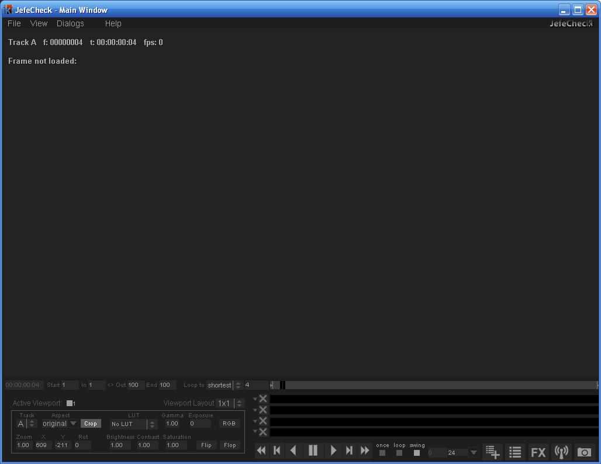

When you open JefeCheck, you see the **Main Window**. To load image sequences into tracks, open the **Load Sequence Manager** with `Ctrl+L` (L is for load) or **File > Load Sequence Manager…**. You can have it open at startup with **Open Load window at startup** in Preferences.

For a single file there is a faster path: **File > Quick Load…** (`Ctrl+O`), or drag the file onto the viewport. Either loads it straight into the active viewport's track.

### The Load Sequence Manager

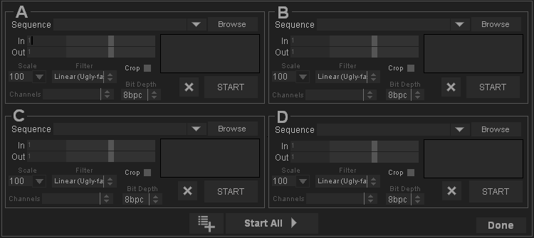

The **Load Sequence Manager** has four strips, one for each track (A, B, C and D). You don't have to use all four. Each strip is the same, so let's look at what each control does. The window stays open while you work in the Main Window; widen it and the strips arrange themselves two by two.

#### Sequence Info Controls

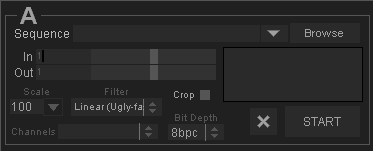

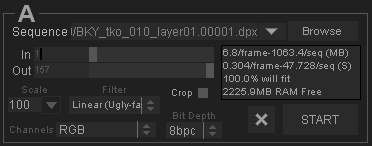

The top row of each strip selects the sequence. Click the **Browse** (folder) button to open a file dialog, then select any file that belongs to the sequence and click Open. You can also type or paste a path into the filename field. The clock button next to Browse lists recently used files.

You can drag a frame of the sequence from your file browser onto the viewport while the Load Sequence Manager is open. The file goes into the first strip as a preview. If the Load Sequence Manager is closed when you drop a file, it loads straight away. If you `Shift`-drag a file, it loads at 50% resolution (`Shift+Ctrl` for 25%). If you drag a folder, the first image or movie file in it (by name) is used.

You can set the folder the file dialogs open in with **Default browse path** in Preferences.

Once you have chosen a file, the strip fills in. The last line of the strip estimates the number of frames, how much memory they will use, and how long they will take to load.

The image you selected is also shown as a preview in the viewport, with information about the sequence on top of it: the filename, format, number of channels, bits per channel, KeyKode and SMPTE timecode (on DPX files that contain them), and how many frames will be loaded.

At this point you could click **Load All** and JefeCheck would start loading. But first, let's review the other options you have at load time.

#### Range Controls

The **From** and **To** boxes select what part of the sequence you want to load. The numbers match the numbers in the file names, so if a sequence starts with frame 153, the smallest value you can choose for From is 153.

#### Load Time Modification Controls

The **Load Time Modification Controls** allow you to alter certain properties of the image sequence as it is loaded into a track. Changes made at load time are "baked" into the track, as opposed to Real Time Modifications which are applied "on the fly" as the picture is being drawn on the screen (you will learn about Real Time Modifications later).

Neither Real Time Modifications nor Load Time Modifications change the original file on disk in any way.

A sequence does not have to fit in memory to be viewed: JefeCheck loads frames around the playhead and unloads frames it no longer needs (see the Track Bar under [Timeline and Track Controls](#timeline-and-track-controls)). The load time controls are still useful to fit more frames, or to make loading faster.

**Table: Load Time vs. Real Time Modifications**

| Load Time | Real Time |
|-----------|-----------|
| Loading a scaled image saves memory. | A scaled image uses the same amount of memory as a full-resolution one. |
| Changes are baked in and can't be reversed unless sequence is reloaded. | Changes are done to the sequence on the fly, and can be turned on and modified instantly. |
| Loading takes longer. | Loading is faster. |
| Works well on old hardware. | Runs best on newer hardware. |

Not all Load Time Modifications have a Real Time counterpart, and therefore using one type of modification should not exclude using the other. This will become clearer when we start to use and understand Real Time Modification Controls.

The Load Time Modification Controls are described below:

##### Scale

The **Scale** box loads the images as proxies: each image is resampled and loaded as a lower-resolution version of itself. This saves memory and helps performance on slower hardware. Choose 100%, 50% or 25%. When you change the scale, the preview in the viewport changes to match.

##### Filter

The resampling filter used when scaling is set for all tracks in **Preferences > General > Default decode filter**: `nearest` (fastest, blockiest), `triangle`, `mitchell` or `lanczos3` (sharpest and slowest, the default). At 100% scale the filter is not used.

##### Crop

Crop is a load time modification that has no Real Time counterpart, and is great for saving memory and improving performance on lower-end computers.

Crop allows you to specify a rectangular sub-section of the image you want to load, and only that part will be loaded into memory. When you tick the **Crop** checkbox, a crop region appears on the preview image in the viewport.

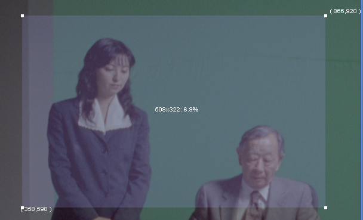 Whatever is under this square will be loaded. To move the Crop square, click and drag it; to resize the square, click and drag the corner squares.

##### BitDepth

The **Bit** box chooses the format the image is stored in, in memory. The formats have different tradeoffs:

- **8-bit** — Converts the image to 8 bits per component for display on normal monitors. This is the format you will usually use: it balances memory use and image quality unless heavy processing is applied later.

- **16-bit** — Stores 16 bits per component. This uses twice the memory of 8-bit, but prevents banding and other color artifacts when you apply heavy real-time color changes.

- **16-half** — 16-bit half-float, the native format of most OpenEXR files. With other formats the effect is the same as 16-bit. Loading OpenEXR images as 16-half keeps the full high dynamic range of the image available for processing. You will usually need the Gamma and Exposure controls to view such images correctly. Each frame uses twice the RAM of an 8-bit frame.

Unless you are having specific problems, 8-bit is the recommended format for most uses, and 16-half for EXR images. The bit depth used by Quick Load and drag and drop is set in **Preferences > General > Default bit depth**.

##### Channels

The **Ch** box lets you choose between the channels present in the image. This is particularly useful for OpenEXR files. If you open a multi-channel OpenEXR image, all the contained channels will be shown here so you can choose which one you wish to load into the track (e.g., Specular, Diffuse, RGBA, Y, Shadows, Depth, etc.).

#### Load All, Reload and Unload

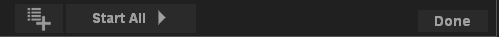

When you have set up the tracks you want, click **Load All** at the bottom of the window. The window closes and every strip that has a file starts loading into its track. To leave without loading, close the window.

Each strip also has a **Reload** button, which reads that track's frames from disk again, and an **Unload & Clear** (trash) button, which unloads the track and clears its fields.

To save the current setup in the playlist, use **Add Current** in the Playlist panel (`F9` or **Window > Playlist**).

> **Summary:** You use the Load Sequence Manager to select what to load into each track and how, and then click Load All. All parameters have the most common values as defaults, so loading can be as fast as selecting a sequence and clicking Load All. You can also drag a frame of the sequence onto the viewport, or use Quick Load.

---

### Movies

Besides image sequences, JefeCheck loads movie files: `.mov`, `.mp4` and `.mxf` containing ProRes (422, 422 HQ, 4444, 4444 XQ), H.264, H.265 or DNxHR. You load a movie exactly like a sequence — Browse to it in the Load Sequence Manager, Quick Load it, drag it onto a viewport or a track lane, or pass it with `--open-file` on the command line — and it lands in a track as a single entry that behaves like a sequence. The range controls, scale, bit depth, crop, hold modes, offsets, the filmstrip and notes all work the same way, and the timeline numbers the movie's frames from 1. The frames are decoded into memory; nothing is ever extracted to disk. Numbers in a movie's name are never read as frame numbers, so `shot_v003.mov` is one clip and `a_001.mov` and `a_002.mov` are never joined into a sequence.

**Colour.** The picture is converted from YUV with the file's own matrix (Rec.709, Rec.601 or Rec.2020) and range (video or full). A file that does not say is treated as Rec.709, video range. Code values are shown straight, as with any other image, and 10- and 12-bit sources keep their precision when the track is loaded at 16 bits.

**Frame rate and timecode.** JefeCheck plays at one rate, the one in the Timeline panel's FPS box. Loading a movie sets it to the movie's exact rate (23.976 is held as 24000/1001, not rounded); when you load several movies the most recent one wins, and opening a saved session keeps the session's rate. Other tracks keep playing one of their frames per timeline frame at that rate. The status bar shows the active movie's source timecode, with drop-frame timecode shown with a `;`. A variable-frame-rate file is played as if it were constant at its average rate, and the status bar says so.

**Sound.** Every track with sound plays at the same time, mixed together. Only one audio stream per file is read, so a camera MXF that stores each channel as its own mono stream plays its first channel only. To mute a track, click the speaker on its lane in the timeline (or right-click the lane and choose **Mute audio**); the lane's waveform dims, and the mute is saved with the session. When you play forward at the movie's own rate the sound leads and the picture follows it, dropping a frame rather than letting the sound stutter. When you step, scrub, or play at any other rate, each frame you see plays its own slice of sound at normal pitch — cut short when playing faster, followed by silence when playing slower, never stretched. Reverse playback is silent. Offsets, ranges and looping apply to the sound as they do to the picture; a held frame does not repeat its sound.

**Limits.** A movie, like a sequence, does not have to fit in memory: a clip longer than memory plays to the end. Frames load ahead of the playhead and frames behind it are unloaded to make room, and the sound is loaded separately, so it never drops out where pictures are missing. Very heavy 4K ProRes 4444 (around 1 Gb/s) can load slower than real time on current machines; what happens then is set by **When loading can't keep up** in Preferences. Frames already in memory play at full rate. **Hardware decoding** in Preferences (Auto, the default, or Off) lets JefeCheck decode movies on the graphics hardware when it can, which is often much faster for heavy files. Rendered output carries no sound.

---

### The Main Window

The **Main Window** is where almost everything else in JefeCheck happens. It has four parts:

- The **Menu Bar** (**File · View · Window · Help**), where you open other windows and change settings.
- The **Viewports Area** in the middle, where you see the image sequences you have loaded.
- The **panels** docked around it: the Plate Manager (`F2`), FX (`F3`), LUTs (`F4`), Notes (`F7`), Timeline (`F8`) and Playlist (`F9`). Show and hide them from the **Window** menu. You can drag a panel to another edge of the window, stack panels as tabs, or float a panel in its own window.
- The **Status Bar** at the bottom, which shows the layout, messages and, for movies, the source timecode. Hide it with **View > Show Status Bar**.

Press `Ctrl+Alt+F` (**Window > Hide Controls**) to hide the menu bar, status bar and every panel. Press it again to bring them back.

What the Viewports Area shows depends on what windows are open. While the Load Sequence Manager is open, you see a preview of the sequences it will load. Otherwise you see whatever track is loaded and assigned to each viewport.

Remember: tracks are independent from viewports — tracks hold sequences, and viewports are used to view those sequences. One viewport can show only one sequence, but one sequence can be seen on multiple viewports.

---

### The Timeline and Plate Manager Panels

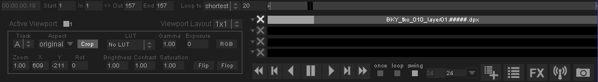

In the 2014 release these controls sat in one Control Bar. In JefeCheck 2.0 they live in two panels:

1. Timeline and Track Controls, and the Playback Controls: the **Timeline** panel (`F8`)
2. Viewport Controls: the **Plate Manager** panel (`F2`)

#### Timeline and Track Controls

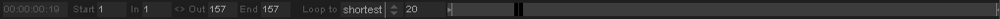

The **Timeline and Track Controls** show where you are in time, and let you choose which frames of the loaded sequences you are looking at.

The Timeline panel has a row of transport controls at the top, the timeline bar under it, and one lane per track under that.

**Current Frame (F)** — Shows the current timeline frame. Type a frame number to jump to it.

**In/Out** — The **In** and **Out** boxes set the range of the timeline that plays. This is helpful if you only want to see a certain range of frames at a time. It is different from loading only a range of frames: you can change In and Out at any time without unloading or reloading anything. The timeline bar and the track lanes always show the In–Out range across their full width, so narrowing the range zooms in. You can also press `I` and `O` to set the In and Out points at the current frame, and `Shift+I` and `Shift+O` to reset them to the ends of the timeline. `Alt+I` sets the In point and loads all tracks from that frame. Whenever you load a sequence, In and Out are reset to fit it.

**The Timeline** — Click or drag on the timeline bar to jump or scrub to any frame. The orange line is the playhead.

**Track Lanes** — Under the timeline there is one lane for each track.

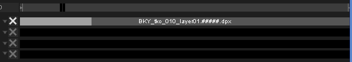

- **The Track Bar** — A bar showing how long the track is in relation to the timeline and other tracks.

  

  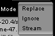 Green segments show the frames that are in memory right now and ready to show. They move with the playhead: frames ahead of it load and turn green, and when memory is full, frames behind it are unloaded and their green disappears (the few just behind the playhead go last, so stepping back stays instant). A frame that is not in memory can still be reached; click it on the timeline and it loads. A frame that can't be read shows black, and playback carries on past it.

- **Thumbnails** — When thumbnails are on (the filmstrip button in the transport row, the lane's right-click menu, or **Timeline thumbnails** in Preferences), each lane shows a filmstrip of the track's frames.

- **Sound** — A track with sound shows its waveform and a speaker icon on its lane. Click the speaker to mute or unmute the track.

- **Frame Offset** — Drag a lane left or right to offset the track a number of frames in relation to the timeline and other tracks. This is useful when the part you want to compare is not at the same frames on both tracks. You can also right-click the lane and choose **Set offset…** to type the offset.

- **Right-click menu** — **Hold last frame**, **Set offset…**, **Mute audio** (on tracks with sound) and **Show frame thumbnails**.

- **Load from here** — `Alt`+click on a lane to load that track starting at the clicked frame.

- **Drop to load** — Drop a file onto a lane to load it into that track.

To unload a track, use **Unload & Clear** on its strip in the Load Sequence Manager.

> **Summary:** You use the Timeline controls to change the timeline range and current timeline frame, which controls what is displayed for each track according to its own settings. You use the track lanes to offset tracks, mute their sound and load from a particular frame.

#### Playback Controls

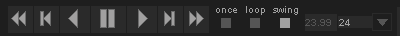

The **Playback Controls** are the transport row at the top of the Timeline panel. They control how the timeline plays.

| Control | Action | Shortcut |
|---------|--------|----------|
| Rewind | Go to the first frame | `Home` |
| Step Back | Move one frame back | `X` or `Left Arrow` |
| Play/Pause | Play or pause | `Space` |
| Step Forward | Move one frame forward | `C` or `Right Arrow` |
| Fast Forward | Go to the last frame | `End` |

Press `,` (or `<`) to set the play direction to reverse, and `.` (or `>`) to set it to forward.

**Loop Modes** — Control what happens when the current timeline value reaches its limit:

- **Once** — The sequence plays once and then stops on the last frame. Shortcut: `8`.
- **Loop** — The sequence plays forward in an infinite loop until paused. Shortcut: `9`. This is the default.
- **Bounce** — The sequence plays forward, and when it reaches the last frame it plays in reverse, going back and forth until paused. Shortcut: `0`.

**FPS** — The target frame rate. JefeCheck tries to keep this rate during playback. Loading a movie sets it to the movie's rate.

**Actual Frame Rate** — The text overlay on each viewport shows the rate playback is actually running at (`fps:`). It shows the target rate while playback keeps up, and the real rate when it can't.

> **Summary:** You use the Playback controls to start and pause playback, set the target frame rate, and choose if and how the sequence loops.

#### Viewport Controls

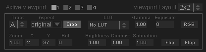

The **Viewport Controls** allow you to specify and control what viewports will be shown, and what track each viewport will display.

**Viewport Layouts:**

- **1x1** — A single viewport using all the space in the viewport area. Shortcut: `Ctrl+1`.
- **2x1** — Two viewports side by side, each using half the horizontal space and full vertical space. Shortcut: `Ctrl+2`.
- **1x2** — Two viewports one on top of the other, each using half the vertical space and full horizontal space. Shortcut: `Ctrl+3`.
- **2x2** — Four viewports, two side by side and another two under them. Shortcut: `Ctrl+4`.

The viewport controls live in the **Plate Manager** dock (`F2`), one card per viewport ("plate"). Click a card, or click a viewport in the viewport area, to make it the active viewport; the active card has an orange border.

**Which cards show.** Choose the mode from **View > Plate Manager Shows**, or right-click an empty part of the Plate Manager (or a card's background). JefeCheck remembers your choice:

- **Active** — only the active viewport's card.
- **Visible** (default) — one card per viewport on screen: one in 1x1, two in 2x1 or 1x2, four in 2x2. Changing the layout updates the cards straight away.
- **All** — all four cards. Cards for viewports the current layout doesn't show have a dashed border and dimmed captions.

**Mini-map.** At the right of the Plate Manager's title bar, a small map of the current layout shows the active viewport in orange. Click a cell to make that viewport active. The title bar otherwise works like any dock's: the buttons at its left close and float the dock, drag it to move or undock the dock, and double-click it to float or re-dock.

**How the cards are arranged** depends on where the dock is:

- **Bottom or top** — wide, short cards in a row, left to right. When the window is too narrow for every card (the Timeline beside the Plate Manager keeps its own width), they wrap onto evenly filled rows (four cards go two and two, never three and one); in a 1280-pixel-wide window two cards fit beside the Timeline, so four plates take two rows. The strip never grows past two rows of cards; with more cards it scrolls, and the active card is scrolled into view. The Timeline always keeps its full height. To fit, this form keeps a few controls behind buttons: Zoom, X, Y and Rotation behind the zoom button (it shows the zoom, e.g. "1.00×"), and Contrast, Brightness and Saturation behind the **Color** button. Click a button to open its controls. The Layer, Aspect and channel controls have no caption here; hover for their names.
- **Left or right** — narrow, tall cards in one column, A to D. The column scrolls, and making a viewport active scrolls its card into view.
- **Floating** — a map of the viewport layout: side by side for 2x1, stacked for 1x2, a 2×2 grid for 2x2 (and for All). The floating window resizes itself when the layout changes.

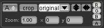

**Per-Viewport Controls:**


**Track** — Select which track this viewport displays: A, B, C or D. If no sequence is loaded in the selected track, the viewport shows nothing. More than one viewport can show the same track at the same time. You can also click a viewport and press `Up` or `Down` to step through the tracks.

**Layer** — Choose the image layer the viewport shows. It reads **Main** until you load a multi-layer EXR, whose layers are then listed here.


**Aspect** — Change the aspect ratio of the image on screen in real time. Click the aspect button to open its list. The default, **source**, uses the image's own aspect ratio. The list has commonly used ratios such as 4:3, 16:9 and 2.35:1, and you can type your own as `x:y` or as a decimal.

By default, changing the aspect ratio stretches the image to fit it. This is useful when viewing material filmed with anamorphic lenses.

Tick **Letterbox** in the same list to show the new ratio with black bars instead of stretching the image. The opacity of the bars is set in **Preferences > General > Aspect-bar opacity**.


**Flip/Flop** — Reflects the viewport vertically (Flip) or horizontally (Flop) or both. Shortcuts: `V` (flip) and `M` (flop); add `Shift` for every viewport.

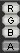

**Channels** — The channel button (it shows **RGB**) steps through RGB, R, G and B, so you can look at one color channel at a time.

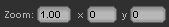

**Transformation Controls** — Zoom in and out with the mouse wheel or a trackpad pinch, or use the **Zoom** box (1 = no zoom). Pan by left-clicking and dragging on the viewport, or use the **X** and **Y** boxes (0 = centered). **Rot** rotates the frame by any number of degrees. When the Plate Manager is docked at the top or bottom, these four boxes sit behind the zoom button (it shows the zoom, e.g. "1.00×"). Press `F` to fit the image to the viewport (`Shift+F` for every viewport). To reset transformations press `Ctrl+R`, or `Ctrl+Alt+R` to reset all viewports.

**Color Correction Controls** — Adjust several color aspects of the viewport. Applied in the following order:

- **LUT** — Apply a 1D or 3D LUT to the viewport. Loading LUTs is described in Section 2.
- **Gamma** — Adjust screen gamma. Shortcut: hold `W` and click-drag on the viewport.
- **Exp** (Exposure) — Adjust screen exposure. Shortcut: hold `E` and click-drag on the viewport.
- **Bri** (Brightness) — Adjust screen brightness. Shortcut: hold `Q` and click-drag on the viewport.
- **Con** (Contrast) — Adjust screen contrast. Shortcut: hold `D` and click-drag on the viewport.
- **Sat** (Saturation) — Adjust screen saturation. Shortcut: hold `S` and click-drag on the viewport.

When the Plate Manager is docked at the top or bottom, Con, Bri and Sat sit behind the **Color** button. Hold `Alt` while dragging to change every viewport. To reset the viewport's color corrections press `Shift+R`, or `Shift+Alt+R` for all viewports.

If you use a color correction often, save it as a **Color Correction Favorite** in one of 5 slots with **View > Color Correction Favorites > Save to Slot 1–5**. Apply a favorite to the active viewport with **Load Slot 1–5** from the same menu. Favorites are kept between launches, and are also saved in each session file.

> **Summary:** You use the layout controls to change how many viewports are displayed and how they are laid out. You use the viewport controls to change the way each viewport is drawn — aspect ratio, zoom, and which track is displayed. You use the color correction controls to change the color properties of the viewport, with the ability to save and load up to 5 favorite color corrections.

---

### The Viewports Area

The central area of the Main Window is the **Viewports Area**. This is where the image sequences and other bits of information are drawn. The viewport area will be divided into up to four sections, depending on the layout chosen.

The sections are not divided by a visible divider, but each viewport has a text overlay that shows valuable information on what is being shown at the moment. When more than one viewport is on screen, a thin orange frame marks the active one. The frame is never drawn in 1x1 and never appears in renders, stamped notes or review thumbnails.

#### Viewport Behavior

Viewports show different information depending on what you are doing at the moment.

**With the Load Sequence Manager Open:**

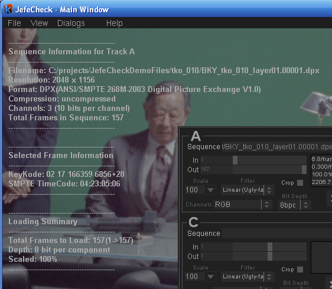

When the Load Sequence Manager is open, each visible viewport shows a preview frame for each sequence that will be loaded into each track. Each viewport shows the preview for whatever track it is assigned to.

Additionally, the text overlay on each viewport will show:

- What track the preview is for
- The filename of the image being displayed (and the source for the sequence)
- The image's resolution in pixels (Width × Height)
- The image's format with a description (if available)
- The image's compression method (if any)
- How many channels (components) are in the image
- How many bits per channel the image has
- The total number of frames identified in the sequence
- KeyKode and SMPTE Timecode information (only available in DPX images that contain such metadata)
- A loading summary showing the total number of frames to be loaded, start and end frame numbers, the bit depth, and the scale

**During Playback:**

Once sequences are loaded and the Load Sequence Manager is closed, you will see the frames in the selected layout.

The text overlay can toggle between three states by pressing `T`: no display, basic information, and basic plus metadata

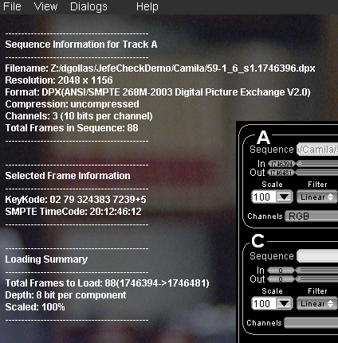 (if the track contains DPX, OpenEXR, or EXIF metadata). Press `Alt+T` to toggle the text display for all viewports.

Basic mode shows:

- The current timeline frame (e.g., `f:0000086`)
- The current SMPTE time relative to the first frame (e.g., `t:00:00:03:14`)
- The current playback frame rate (e.g., `fps:24.00`)
- The filename of the image being shown
- The image resolution, number of channels, and bits per component (e.g., `2048x1156x3 10bpc`)

When DPX metadata is present and enabled, the following additional fields are shown:

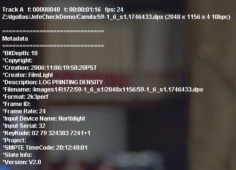

- Timecode (from the DPX TV Header)
- KeyKode (derived from the DPX Motion Picture Header)
- Filename (from DPX File Information Header)
- Source Filename (from DPX Image Orientation Header)
- Frame ID (from DPX Motion Picture Header)
- Project (from DPX File Information Header)
- Slate (from DPX Motion Picture Header)
- Creator (from DPX File Information Header)
- Input Device (from DPX Image Orientation Header)
- Input Serial (from DPX Image Orientation Header)
- File Size in MB, KB and Bytes (from DPX File Information Header)
- Frame rate (from DPX Motion Picture Header)
- Format (from DPX Motion Picture Header)
- Creation Time (from DPX File Information Header)
- Source Creation Time (from DPX Image Orientation Header)
- Copyright (from DPX File Information Header)

For OpenEXR images, the metadata shown is:

- Focus Distance
- Exposure Time
- Lens Aperture
- ISO Speed
- KeyKode
- Timecode
- Location (Longitude, Latitude, Altitude)

For images with EXIF metadata, all available fields will be displayed.

**LUT Visualization:**

The LUTs panel shows a graphical representation of a 1D or 3D Lookup Table. See Section 2: Process for more information.

**Notes:**

Review notes drawn on a frame show on top of it. Press `N` (**View > Show Notes**) to show or hide them. See [Review Notes](#review-notes).

**On-screen help:**

Press `H` to show or hide a list of keyboard shortcuts over the viewports.

#### Viewport Interaction

Using the mouse and keyboard you can interact with the viewports to modify their parameters and obtain information about what is being displayed.

| To do this... | ...do this |
|--------------|------------|
| Zoom in and out | Move the mouse wheel up or down, or pinch on a trackpad. |
| Gang Zoom (all viewports) | Pinch while holding `Alt`. |
| Pan | Left-click and drag on the viewport. |
| Gang Pan (all viewports) | Left-click and drag while holding `Alt`. |
| Fit the image to the viewport | Press `F` (`Shift+F` for all viewports). |
| Reset viewport transformations | Select the viewport and press `Ctrl+R`. |
| Reset all viewport transformations | Press `Ctrl+Alt+R`. |
| Adjust Gamma | Left-click and drag while holding `W`. |
| Adjust Exposure | Left-click and drag while holding `E`. |
| Adjust Brightness | Left-click and drag while holding `Q`. |
| Adjust Contrast | Left-click and drag while holding `D`. |
| Adjust Saturation | Left-click and drag while holding `S`. |
| Adjust every viewport's color | Add `Alt` to any of the five above. |
| Reset viewport color corrections | Select the viewport and press `Shift+R`. |
| Reset all color corrections | Press `Shift+Alt+R`. |
| Show a remote pointer | In a remote session, left-click and drag while holding `Shift`. |

> **Summary:** The Viewport Area is where you will see the Viewports displaying all the information contained in the tracks. You can interact with the Viewports using the mouse and keyboard and display text information on what you are looking at, including DPX, OpenEXR and EXIF metadata when present.

---

### The Menu Bar

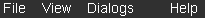

At the top of the Main Window is the **Menu Bar**, from which you can access settings that modify the way the program behaves and the viewports are displayed. Most menu items have a keyboard shortcut displayed next to them.

#### File Menu

- **Quick Load…** (`Ctrl+O`) — Loads a file straight into the active viewport's track.
- **Load Sequence Manager…** (`Ctrl+L`) — Opens the Load Sequence Manager.
- **Save Session** (`Ctrl+S`) — Saves a complete JefeCheck session, including loaded tracks, load-time parameters and viewport settings, into a single `.jcs` file for later recall.
- **Save Session As…** — Saves the session under a new name.
- **Open Session…** (`Ctrl+Shift+O`) — Opens a saved session, replacing the current tracks and settings.
- **Recent Sessions** — The last few sessions you saved or opened.
- **Open Playlist…** — Opens a saved `.jpl` playlist (the Playlist panel itself is **Window > Playlist**, `F9`).
- **Recent Playlists** — The last few playlists you saved or opened.
- **Stamp Notes into EXR…** — Saves a copy of the current frame as an EXR with its review notes attached.
- **Export Review Summary…** — Writes the notes on everything in the current session to a PDF, text or CSV file, organized by shot, review round and frame. The PDF also shows a thumbnail of each noted frame with its markup. Noted frames that are not in memory are loaded for the export as needed. Use it to send feedback to people who don't have JefeCheck.
- **Export Review Package…** — Bundles the current session, its notes and any LUTs you loaded yourself into a single `.jcreview` file you can hand to someone else. Leave **Include media** ticked to copy the footage into the package so it opens anywhere. Untick it when everyone can reach the same storage; JefeCheck will then look for the footage where it was, and by file name in the other person's Search Paths.
- **Open Review Package…** — Opens a `.jcreview` file. JefeCheck loads its session and LUTs, finds the footage (inside the package, where it was originally, by file name in your Search Paths, or by asking you to locate it), and adds the package's notes to any notes you already have on that footage — nothing of yours is removed. When it's done, it lists anything it couldn't find or load. To also match footage that was moved and renamed, turn on **Also match moved media by fingerprint** in **Preferences > Search Paths** (slower).
- **Preferences…** (`Ctrl+P` or `Ctrl+,`) — Opens the Preferences window. See Section 4: Other Stuff.
- **Quit** (`Ctrl+Q`) — Quits JefeCheck.

#### View Menu

- **Fullscreen** (`F11` or `Cmd+Ctrl+F`) — Toggles full-screen mode. With two monitors, full screen uses the monitor the main window is on.
- **Show Histogram** (`Ctrl+H`) — Shows an RGB histogram for the active viewport. You can drag the histogram within the viewport.
- **Show Histogram (All Plates)** (`Ctrl+Alt+H`) — Shows a histogram on every viewport.
- **Show Notes** (`N`) — Shows or hides review notes on the viewports.
- **Show Status Bar** — Shows or hides the status bar.
- **Plate Manager Shows** — Active, Visible or All plate cards in the Plate Manager (also on right-click in the panel).
- **Color Correction Favorites** — Save the active viewport's color correction to one of 5 slots, or load a slot into it.
- **Fit to Screen** (`F`) — Fits the current frame to the viewport. Smaller images are not enlarged, but large images are zoomed out. `Shift+F` fits every viewport.
- **Flip Vertical** (`V`) — Flips the viewport vertically. `Shift+V` flips every viewport.
- **Flop Horizontal** (`M`) — Flops the viewport horizontally. `Shift+M` flops every viewport.
- **Text Overlay Mode** (`T`) — Steps through the text overlay modes. `Alt+T` changes every viewport.
- **Reset Plate** (`Ctrl+R`) — Resets the active viewport's transformations. `Ctrl+Alt+R` resets every viewport.
- **Reset Color Correction** (`Shift+R`) — Resets the active viewport's color corrections. `Shift+Alt+R` resets every viewport.

#### Window Menu

The **Window** menu shows and hides every panel. A checkmark means the panel is showing; showing a panel also brings it to the front of its tab group.

- **Plate Manager** (`F2`) — the per-viewport controls.
- **FX** (`F3`) — the effect controls for the active viewport. See Section 2: Process.
- **LUTs** (`F4`) — the LUT browser. See Section 2: Process.
- **Notes** (`F7`) — review notes for the active viewport's media.
- **Timeline** (`F8`) — transport, frame range and the track lanes.
- **Playlist** (`F9`) — the playlist.
- **Remote Session…** (`F5`) — the remote session panel. See Section 3: Share.
- **Render…** (`F6`) — the Render window. See Section 4: Other Stuff.
- **Hide Controls** (`Ctrl+Alt+F`) — hides the menu bar, status bar and every panel; press it again to bring them back.
- On macOS, the standard **Minimize** (`Cmd+M`), **Zoom** and **Bring All to Front** commands.

#### Help Menu

- **User Manual** (`F1`) — Opens this user manual.
- **Quick Start Guide** — Opens the Quick Start Guide.
- **Report an Issue…** — Opens the JefeCheck issue tracker on GitHub.
- **Toggle On-Screen Help** (`H`) — Shows or hides the keyboard shortcut list over the viewports.
- **About JefeCheck** — Shows the version, author and license.
- **System Specs…** — Shows your graphics hardware and what it supports.

---

### Playlists

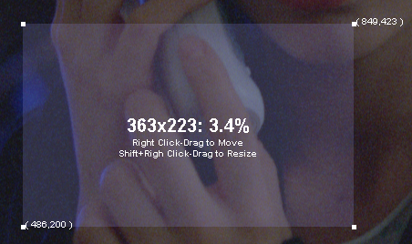

**Playlists** allow you to save a series of "Playlist Items" and then recall them at will. A playlist item is NOT a single sequence — it holds much more information, including what sequences are loaded in what tracks and with which parameters, the viewport layout, playback settings, and any FX stacks applied to the viewport. This way, jumping from one setup to another is a snap.

For example, you might be reviewing a series of shots for a show. Say for shot 1 you load the original scans in Track A and the completed shot in Track B. You apply a blend FX between them and show it in a side-by-side layout. You then add this to a playlist. All the settings will be recalled whenever you double-click on that item, not just what was loaded into Track A.

> **Power Tip:** You can think of a playlist item as a snapshot of the current state of JefeCheck.

To open the Playlist panel, use `F9` or **Window > Playlist**.

You add items to a playlist in three ways:

1. **Add Current** saves the current setup as a new item.
2. **Add Files…** builds a new item from one or more files, one track per file.
3. Dropping media files on an empty part of the list adds a new item.

You can append tracks to an item by dropping media onto that item's card, or with **Append tracks…** in its right-click menu.

Each item shows a card per track with its file name, range and scale. Click a card's arrow to show or hide the details. **Compact** shortens the cards, and **Full paths** shows whole paths instead of file names.

To load a playlist item, double-click on it or select it and press `Enter`.

You can move an item by selecting it and pressing `Shift+Up` or `Shift+Down`, or with the up and down buttons. Remove the selected item with `Delete` or `Backspace`, or the remove button. The clear (trash) button removes every item.

With **Auto-advance** on, when an item has played through once the next item loads and plays. With **Loop playlist** on, the last item is followed by the first. **Scale override** loads every track of an item at the scale you choose next to it, whatever scale the item was saved with.

Keep in mind that only items loaded from the Playlist panel will be loaded in remote sessions (see Section 3: Share).

Save the playlist with the save button and choose a file name; it is saved with a `.jpl` extension. Open one with the open (folder) button or **File > Open Playlist…**, or drop a `.jpl` file onto the Playlist panel. Opening a playlist replaces the items in the list.

---

### Review Notes

Notes are drawings and short texts you put on a frame during a review. They belong to the footage, not to the session, so they show again whenever the same footage is loaded.

Open the **Notes** panel (`F7` or **Window > Notes**). It shows the notes for the active viewport's footage, grouped by review round.

1. Pick a tool: **Freehand**, **Arrow**, **Box** or **Text**. Click the tool again to put it down, or press `Escape`.
2. Pick a **Colour** and a **Size** if you like.
3. Drag on the viewport to draw. With the Text tool, click where the note goes and type it.

Select a note in the list and click **Remove Note** to delete it. **Lock Round** freezes the current round's notes; click it again to reopen the round.

Press `N` to show or hide notes on the viewports. To share notes, see **Export Review Summary…** and **Export Review Package…** in the [File Menu](#file-menu).

---

## SECTION 2: PROCESS

In this section you will learn how to load and use LUTs and JefeCheck FXs.

One of JefeCheck's most powerful features is the ability to process the image sequences you are watching with a variety of Lookup Tables and other effects. JefeCheck uses a simple plug-in system to control how the images are processed.

### Real Time Modifications vs Load Time Modifications

As mentioned in Section 1, there are two ways to process an image in JefeCheck: at Load Time and in Real Time. Continuing the film analogy from Section 1, tracks are like film reels, and viewports are a combination of projectors and projection screens.

You can think of Load Time Processing as making a different print of the film reel — maybe you crop the image, maybe you print it at a different size. No matter how much you adjust the projector lenses or filters, the images on that different print will be changed, and what you see on screen won't go back to normal until you reload the original print.

In contrast, Real Time Modifications are equivalent to loading the original film reel on the projector and then putting different filters or lenses on it. You don't have to make a different print in order to see a different effect — you simply swap one filter for another, but the reel remains the same.

In JefeCheck, Load Time Modifications are done in the Load Sequence Manager. Real Time modifications are applied on the fly using the power of your computer's graphics card.

JefeCheck can load a variety of Lookup Table formats, but the easiest way to get a 3D LUT is to make your own. It is really easy to emulate any color look by using a custom-made JefeCheck LUT. If you can render a single frame through your color pipeline, then you can use the color output of that pipeline in JefeCheck! All you do is process the provided identity image (`UnitCube.tga`, in the FX folder) through your pipeline — the resulting image (which should be the same size as the original) is loaded into JefeCheck and converted to a 3D Lookup Table that will emulate whatever color alterations your pipeline made to the original image. See Section 4: Other Stuff to find out how to make your own 3D LUT.

You can also load and use 1D LUTs. The file format for a 1D LUT is a simple text file. To learn how to write your own 1D LUT see Section 4: Other Stuff.

JefeCheck also reads `.cub` (Truelight) and `.cube` 3D cube files.

To load and inspect LUTs, be they 3D or 1D, you use the **LUTs** panel.

---

### The LUTs Panel

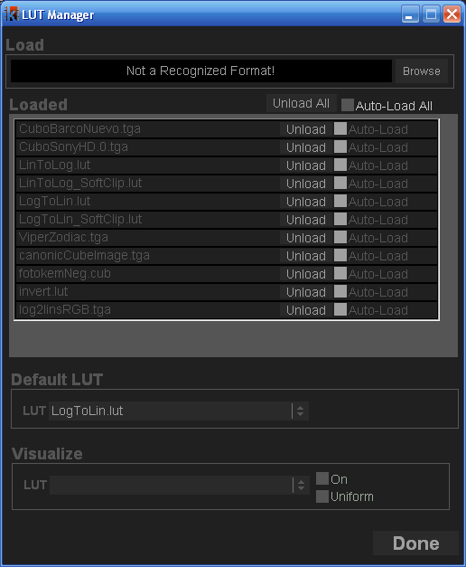

Open the **LUTs** panel with `F4` or **Window > LUTs**.

At startup JefeCheck loads every LUT (`.lut`, `.cube`, `.cub` and `.tga`) in its FX folder, so the panel is not empty the first time you open it. The list shows each LUT's name, type, size and depth; click a column header to sort by it.

To load another LUT, drop a `.lut`, `.cube` or `.cub` file onto the panel. Click the Refresh button to rescan the LUT folders and rebuild the list.

To apply a LUT, select it and click **Apply to active plate**, or double-click it. You can also choose a LUT in the **LUT** box on a viewport's card in the Plate Manager.

#### Visualizing LUTs

With **Preview** ticked, the panel shows the selected LUT under the list. Drag the divider to give the preview more room.

**1D LUTs** are plotted as curves, with the input value on the X axis and the output value on the Y axis.

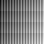

**3D LUTs** are displayed as a color cube you can rotate, with a colored point at each sample. A canonical 3D LUT generates a perfect color cube, while a modified cube displays other characteristics.

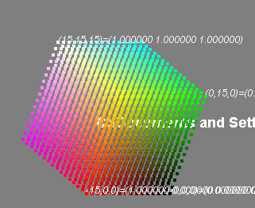

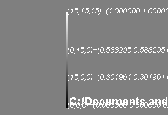 With **Deformed** ticked, each point sits in 3D space at its output RGB value. With it off, the samples are spaced uniformly, forming a perfect cube, but are still colored with their output values — this lets you compare two cubes without being distracted by geometric deformations. **Dots**, **Grid** and **Solid** choose how the cube is drawn, the marker box chooses the shape of each point, **Spin** turns the cube on its own, and **Bg** sets the background brightness.

#### Using LUTs

A viewport's LUT (from its card or **Apply to active plate**) is part of its color correction. LUTs can also be applied in an FX stack: Real Time modifications are called **FXs** within JefeCheck, and JefeCheck comes with two FXs for LUT application, one for 1D LUTs and one for 3D LUTs. See Section 4: Other Stuff for an explanation of the included FXs.

---

### Loading FXs

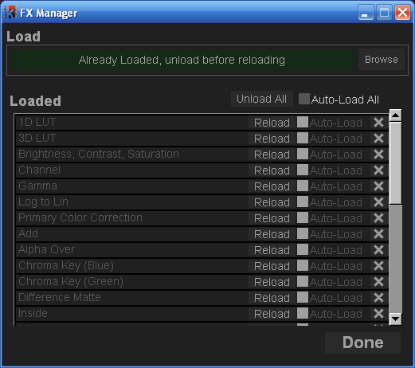

There is no separate FX manager in JefeCheck 2.0. At startup JefeCheck loads every FX in its FX folder, and they are all listed in the FX panel's **+ Add FX** menu. To add an FX of your own, put its `.jfx`, `.frag` and `.vert` files in the FX folder and restart JefeCheck.

---

### The FX Panel

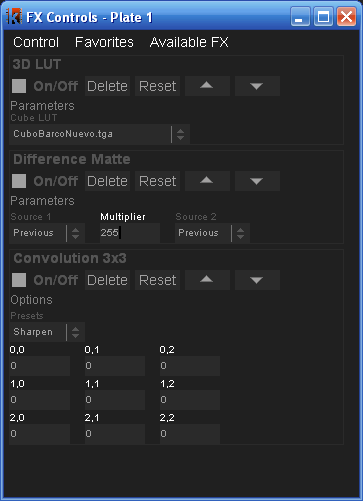

You use FXs by applying them to viewports. A viewport can have no FX applied, or as many as your graphics card performance will allow while maintaining a desired playback frame rate. To apply an FX, use the **FX** panel (`F3` or **Window > FX**).

FXs are applied to each viewport independently — you can have one viewport playing back the unprocessed sequence while on another viewport you have the sequence playing with a LUT or Primary Color Correction applied.

The FX panel always shows the active viewport's FX stack. To work on another viewport, click it. Click **+ Add FX** and choose an FX from its category submenu (Color, Comp, Special, Transitions and so on).

Each FX you add appears as a card in the **FX Stack**. FXs are applied from the top card down, so the output of one FX is passed to the one below it.

#### Common FX Controls

Every FX card has the same header:

- **Drag handle** — Drag the card up or down to move the FX in the stack.
- **Power button** — Turns the FX on or off. This lets you compare with and without the effect without having to remove and re-apply it.
- **Collapse arrow** — Hides or shows the FX's controls.
- **Remove** — Removes the FX from the stack.

  

Most FXs have parameters you can customize. The effect's `.jfx` file decides how each number is drawn:

- **Slider row** — label, value field, slider and a reset dot, one per line. The slider covers the effect's usual range (its *soft range*); you can still type a value past it, and the slider then stays pinned at its end.
- **Knob** — label above a small rotary knob, value field below. Drag up or down on the knob to turn it. Knobs sit side by side.
- **Field** — label and value field only, side by side with other fields (for example X and Y, or the nine cells of a 3×3 matrix).

Every value field works the same way:

- **Drag left or right** on the field to scrub the value. Dragging across about 200 pixels covers the whole slider range.
- Hold **Shift** while dragging (field, knob or slider) for fine adjustment, at a tenth of the speed.
- **Double-click** the field (or press **Enter** or **F2** when it has focus) to type a value; **Enter** commits it and **Esc** cancels.
- The **reset dot** at the end of a slider row returns that parameter to its default. Every parameter also has a right-click **Reset to default** menu.
- A parameter's label turns **orange** while its value differs from the default.

Image inputs are chosen from a list: **Previous** (the result of the FX above) or **Track A** to **Track D**. LUT inputs list the loaded LUTs.

When the FX dock is narrow, controls that share a line wrap onto the next line instead of being cut off.

The FX stack of every viewport is saved with the session and with each playlist item.

#### Performance

A viewport can have many FXs stacked one on top of the other. You can apply an arbitrary number of FXs, but the performance and frame rate will vary depending on your graphics hardware. When selecting graphics cards, the key spec to look for is the number of Pixel Shaders or Pixel Units (called Stream Processors on newer cards) — the more of these a graphics card has, the better FX stack performance will be.

Tests have shown very good performance on mid-range gaming-level video cards with more than 5 FXs applied on a 2K resolution sequence.

---

## SECTION 3: SHARE

In this section you will learn how to start and participate in a JefeCheck Remote Session.

In the previous sections you learned how to use JefeCheck to play sequences and process them using FXs. The last big feature of JefeCheck is the ability to do all that in collaboration with people who might be miles away.

Collaborating with other people over a network connection or the Internet is called a **Remote Session** in JefeCheck.

### Remote Sessions

When two or more people have a JefeCheck Remote Session, each participant has a copy of JefeCheck running on their computer, along with a local copy of the sequences that will be loaded for playback. JefeCheck does not send the footage over the network (it does send the LUTs and FXs a participant is missing), for two reasons:

1. Sending image information requires great amounts of bandwidth that might not be available to all participants.
2. Even if everybody had sufficient bandwidth, sensitive content such as frames from an unreleased movie is usually copied and sent on a need-to-have basis through specialized, controlled, and secured channels managed by a data wrangler.

A JefeCheck Remote Session requires at least two participants, one of whom will act as a Session Server. The process can be summarized in three steps:

**Step 1 — Start a Server:** One participant, usually the one with the fastest connection and best computer, starts a server from JefeCheck. This participant will need to have an IP address that other players can access from their network, normally called a Public Address if the session is being held over the Internet. If you don't have a public IP address you will not be able to host a remote session over the Internet. This is not an issue when starting a server for a session over a local network or a VPN.

**Step 2 — Other Participants Connect to the Server:** Once the server is started, the server's IP address and port is communicated to other participants — over the phone, email, instant messaging, or whatever method you prefer.

**Step 3 — Play!** When everybody has connected to the server, anything someone does on their copy of JefeCheck will be mirrored on everybody else's copy, including the server.

Everything involved in setting up or joining a Remote Session is done from the **Remote Session** window.

### The Remote Session Window

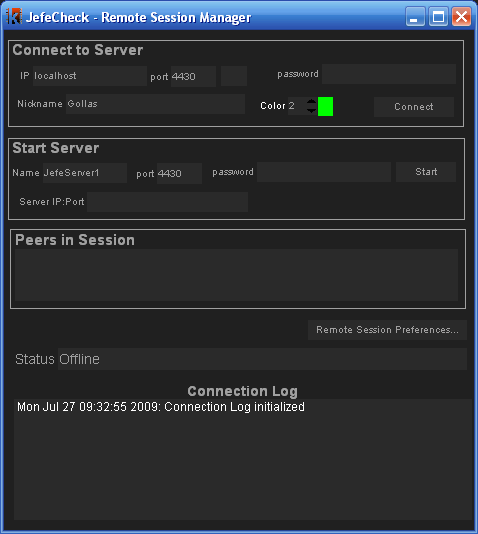

To start or join a remote session, open the **Remote Session** window (`F5` or **Window > Remote Session…**). It stays open while you work, so you can watch the status, the participants and the chat during the session. At the top, **Host**, **Cloud** and **Join** switch between the three ways to start.

#### Connecting to a Server

In order to connect to a JefeCheck session that is already running:

1. Choose **Join**.
2. Type a **Nickname** — other participants will identify your actions with this name.
3. Set **Join with** to **IP address**.
4. Type the host's address in **Server** and its port in **Port**.
5. Type the **Password** if the host set one.
6. Click **Join**.

The status line at the top shows whether the connection worked. Once you are connected, the window shows the participants and the chat, and a **Leave** button.

If the host started the session through **Cloud**, set **Join with** to **Session code** and type the code they give you instead of an address.

#### Starting a Server

To host a remote session that other users can join:

1. Choose **Host**.
2. Type a **Name** for the session.
3. Type the **Port** to listen on (the default is 60000).
4. Type a **Password** (recommended).
5. Click **Start hosting**.

Tell the other participants your computer's IP address and the port. The host ends the session with the **End Session** button.

**Cloud** hosts the session through a JefeCheck Cloud coordinator instead, so participants join with a session code rather than an IP address. It needs you to sign in, and the coordinator's address is set in **Preferences > Remote**.

### Participating in a Remote Session

Once a server is set up and at least one more user is connected, you can start using JefeCheck the way you normally would.

#### Loading Sequences in a Remote Session

Loading sequences in a remote session is done through the **Playlist** panel. Only sequences loaded through the Playlist panel will be automatically loaded on other participants' computers.

Remote session users may have different file system organizations — one participant might load images from a CD, another from a network share, and a third from a local drive. If user 1 loads a playlist item with a path like `c:/MyDocuments/images/`, a remote user without that exact path or a Linux/Mac user will not be able to load the file.

To resolve this, set up **Search Paths** in the JefeCheck Preferences window. When a remote playlist item is loaded, JefeCheck will first try to find it at the received path; if it can't be found, it will search the configured search paths and load the first match. Be careful not to point search paths at root or `C:\` — that could slow down searching significantly. Usually you set search paths to point to your project's render folder, or copy files for remote review into a special folder.

To add a search path: open the **Preferences** window, go to **Search Paths**, tick **Use search paths**, click the add button and choose the folder. You can add as many search paths as you wish. Tick **Search recursively** to also search within subfolders.

One important thing to note: although all users must have the same image sequences, they don't have to load them at the same scale. A user with a laptop can load at 50% or 25%, while a user on a bigger workstation loads at full resolution (see Load Time Modification Controls: Scale).

Even if a remote user loads a playlist item that contains sequences at 100%, you can override this in your own Playlist panel: tick **Scale override** and choose the scale next to it.

If you know how to use JefeCheck then you know how to participate in a Remote Session. You can pan, zoom, change layouts, play, scrub the timeline, advance or rewind frames, change In and Out points, change the frame rate, change the playback mode, add and modify FXs, flip, flop — everything. Any playlist item you load during a remote session will also be loaded in the remote participants' sessions. Whenever a new user joins a session, their playlist items will be merged with the ones already on the server.

There are only two new commands involved in a Remote Session: **Chat** and **Remote Pointers**.

### Chat

In JefeCheck you can text chat with all other participants.

Type a message in the box under the chat in the Remote Session window and press `Enter` (or click Send).

You can also chat from the viewport: click the viewport and press `Enter` to start a message, type it, and press `Enter` again to send it or `Escape` to cancel. Messages show over the bottom of the Viewports Area and fade away after a few seconds. The chat's font size, opacity, number of lines and fading are set in **Preferences > Remote**.

### Remote Pointers

Remote pointers let everybody in the session see exactly where you are pointing at on the screen with your mouse.

To use a remote pointer, hold `Shift` and left-click and drag on the Viewport Area. Everybody else in the session sees a point with your nickname next to it, and can watch it move as you move the mouse. Your pointer's color is set in **Preferences > Remote**.

Note that if users have loaded the same sequence at different scales, JefeCheck's remote pointers compensate for the difference in scales and different monitor resolutions. Remote pointers work by showing where you are pointing at on the **image**, not at where you are pointing on your monitor.

Using both the chat and Remote Pointers you can get very useful interaction between all participants in the session. Combining that with FXs to change colors, bring up difference mattes, or anything else you can think of makes JefeCheck a very powerful remote review tool.

---

## SECTION 4: OTHER STUFF

This section covers topics that don't quite fit anywhere else: the Preferences Window, the Rendering Window, the included FXs, and how to create your own custom 1D/3D LUTs and FX plug-ins.

### Preferences Window

The **Preferences** window (`Ctrl+P` or **File > Preferences…**) changes settings that affect the whole application.

Most changes show straight away, for example the viewport background or the text style, so you can see them while the window is open. Click **Done** to keep your changes, or **Cancel** to put everything back as it was when you opened the window.

Choose a section from the list on the left:

#### General

- **Background color** — The color behind and around the images. Opens a color picker.
- **Checkerboard background** — Draws a checkerboard (two shades of the background color) instead of a flat color. Useful for judging image edges and alpha.
- **Default browse path** — The folder file dialogs open in when there is no more recent location.
- **Start in fullscreen** — Opens the main window in full screen at startup.
- **Open Load window at startup** — Opens the Load Sequence Manager at startup.
- **Enable crash recovery session** — Keeps a snapshot of the current session so it can be restored after an unexpected exit.
- **On launch** — What to do with the previous session at startup: **Start empty**, **Reopen last session**, or **Ask**.
- **Aspect-bar opacity** — Opacity of the letterbox bars (0 = invisible, 1 = solid).
- **Timeline thumbnails** — Shows filmstrip thumbnails on the timeline's track lanes.
- **Feedback message size** and **Feedback fade delay (s)** — The size of the messages shown over the viewport when you change a setting with a shortcut, and how long they stay.

**Playback & Engine:**

- **Memory limit (% of RAM)** — Frames load while the whole machine's memory use (all programs, not just JefeCheck) stays under this share of its RAM. Above it, a frame behind the playhead is unloaded for each one that loads; nothing is unloaded while nothing is loading. The playhead and a few frames ahead of it always load, even over the limit, so footage can still be viewed on a busy machine. From 50% to 100%; the default is 90%. A new value applies to the next frame that loads.
- **When loading can't keep up** — What playback does when the next frame isn't in memory yet:
  - **Keep time (skip frames)** — The sound keeps playing on time and the picture holds the last loaded frame, skipping the frames that are not ready. Skipped frames still load, so the next pass shows them. Playback waits a fraction of a second after you press play or jump, so it doesn't start on a frozen frame.
  - **Show every frame (slow down)** — Every frame is shown in order and playback runs only as fast as frames load; the FPS display shows the slower rate.
  - **Automatic** (the default) — Keep time when a track has sound, show every frame when none has.
- **OIIO decode threads** — The number of worker threads OpenImageIO uses for resizing and some decoders (0 = automatic). If you often load several tracks at once, a low value (1–2) can work better; for a single heavy sequence, leave it on automatic.
- **Hardware decoding** — **Auto** decodes movies on the graphics hardware when it can (VideoToolbox on macOS, D3D11VA on Windows, VAAPI or NVDEC on Linux) and in software otherwise. **Off** always uses software. Applies to movies loaded after you click Done.
- **Default decode filter** — The resampling filter used when a sequence is loaded at a reduced scale: `nearest` (fastest), `triangle`, `mitchell` or `lanczos3` (sharpest, the default).
- **Default bit depth** — The bit depth used for files loaded with Quick Load or drag and drop: 8, 16, 16-half or 32-float. Tracks already loaded keep their depth until reloaded.

#### Text

Settings for the information text drawn on each viewport: **Size**, **Color**, **Hinting** (Light, Normal or Force autohint), **Filter** (Nearest for pixel-exact text, Linear for smoother text), **Gamma** (lower values draw text bolder), and a drop shadow (**Shadow enabled**, **Shadow offset X/Y**, **Shadow blur radius**, **Shadow color**) that keeps the text readable over bright images. The viewport updates as you change them.

#### Formats

- **EXR: ignore display window** — EXR images contain both a data window and a display window. JefeCheck shows the data inside the full display window unless this is ticked, in which case only the data window is shown. You usually want this off.
- **EXR: ignore header aspect ratio** — The EXR header contains a pixel aspect ratio. JefeCheck corrects for non-square pixels unless this is ticked. You usually want this off.
- **Read straight (unassociated) alpha** — Reads alpha as non-premultiplied instead of premultiplied. Match this to how your images were made. Takes effect on the next load.
- **Apply embedded orientation** — Rotates or flips stills (JPEG, TIFF) to match their orientation metadata. Off by default. Takes effect on the next load.

#### Search Paths

- **Use search paths** — When a file is not found at its original path (for example in a remote session or a review package), look for it in the folders listed below.
- **Search recursively** — Also search inside the subfolders of each search path.
- **Also match moved media by fingerprint (slower)** — When opening a review package, also look for footage that was moved and renamed by comparing its content. Off by default.
- The folder list, with buttons to add and remove folders. Folders are searched in order.

#### Remote

- **Nickname** — Your name as other participants see it.
- **JefeCheck Cloud: Coordinator** — The address of the coordinator used by the Cloud option in the Remote Session window.
- **Chat** — **Fade delay (s)**, **Auto-fade chat**, **Chat text background**, **Font size**, **Opacity** and **Display lines** for the chat shown on the viewport.
- **Remote pointer** — **Fade delay (s)** (how long a pointer stays after it stops moving) and **Color** (your pointer's color as others see it).

---

### Rendering

Although JefeCheck is not a finishing tool, you can output high-quality images of your on-screen results as JPEG, OpenEXR, TIFF, Targa, BMP or PNG files, or as an H.264, H.265 or ProRes movie.

The render process is as follows: load a sequence and apply FXs and color corrections to the viewport where it is shown (if desired). Then open the **Render** window (`F6` or **Window > Render…**), set a few parameters, and click **Render**. The render includes the viewport's FX stack, its color correction and its LUT. You can cancel the render at any time by clicking the Render button again (its label changes to **Cancel** during the render). Each frame is loaded for the render as it is needed, so you can render frames that are not in memory, and rendering does not change which frames are loaded. When the render ends, the playhead is back where it was before you started.

### The Render Window

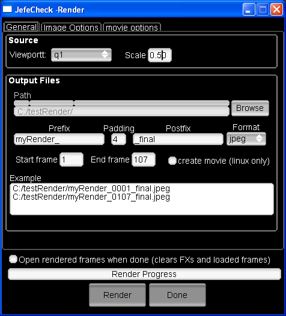

The **Render** window has these settings:

- **Quadrant** — The viewport to render (Plate 1 to Plate 4).
- **Format** — JPEG, OpenEXR, TIFF, Targa, BMP, PNG, H.264 (MP4), H.265 (MP4) or ProRes (MOV). The movie formats need FFmpeg, which release builds include; without it they are marked "ffmpeg not found".
- **Quality** — Options for the chosen format:
  - **JPEG** — quality, **Progressive**, and **Chroma** subsampling (4:4:4, 4:2:2 or 4:2:0).
  - **OpenEXR** — **Depth** (Half or Float) and **Compression**.
  - **TIFF** — **Depth** (8-bit or 16-bit) and **Compression** (LZW, None or ZIP).
  - **PNG** — **Depth** (8-bit or 16-bit) and **Compression (0–9)**.
  - **Targa**, **BMP** — no options.
  - **Movies** — **FPS**, **Rate** (**Quality**, a 0–100 value, or **Bitrate** in Mbps) and the encoder **Preset**.
- **Frames** — The first and last frame to render, in timeline frames. **Auto-range** fills them from the timeline's In and Out points.
- **Padding** — The number of digits in the frame numbers of image files.
- **Resolution** — Source (100%), 75%, 50%, 25% or Custom width and height.
- **Framing: Bake aspect / crop bars into output** — Burns the viewport's letterbox bars into the output. Off by default.
- **Notes: Burn in notes** — Draws the frame's review notes into the output.
- **Output dir**, **Prefix**, **Postfix** — Where the files go and how they are named:
  ```
  Prefix####Postfix.ext
  ```
- **Preview** — An example of the output file name.

A progress bar shows how far the render has got. When it ends, click the status link to open the output folder. Click **Done** to close the window. Rendered movies have no sound.

---

### Included FXs

A list of the FXs installed with JefeCheck follows, grouped as in the **+ Add FX** menu.

#### Color

- **1D LUT** — Apply a 1D LUT color transformation. Select the 1D LUT you want to use from the list.
- **3D LUT** — Apply a 3D LUT color transformation. Select the 3D LUT you want to use from the list.
- **Brightness, Contrast, Saturation** — Modify the brightness, contrast, and saturation of the image. You can also change the average luminance for the contrast operation.
- **Gamma** — Modify the gamma of the image.
- **Primary Color Correction** — Modify the brightness, contrast, and saturation of the image on a per-component basis.
- Also in this group: **Channel** and **Log to Lin**.

#### Compositing

- **Chroma Key (Blue)** and **Chroma Key (Green)** — Do a quick blue or green screen extraction and composite. Select the bottom and top images, a bias parameter; optionally show matte only, or show the clean plate without the composite.
- **Difference Matte** — Apply a difference matte operation on two images to expose the differences between them. Select the two images to compare and a multiplier. The operation is: `absoluteValue(A-B)*multiplier`.
- **Inside** — Perform an inside composite.
- **Mix** — Mix two images together according to an amount parameter.
- **Ondita** — Proof of concept shader.
- **Over** — Perform an over composite operation. You can select the source and target image, the matte image, and the method used to extract the mask. You can also determine if the target image is premultiplied or not.
- **Split** — Split the frame between two different images. The split is performed on a slope, and the axis of the slope can also be determined. The edge of the split can also be smoothed.
- **Substract** — Perform a subtract operation on two images.
- Also in this group: **Add**, **Alpha Over**, **Flip Horizontal**, **move2D**, **Multiply** and **Stereo SxS Squeeze**.

#### Special

- **Anaglyph Color Stereo** — Create an anaglyph color stereo image from a left/right pair. Each "eye" should be loaded in a different track. The left image is colorized to cyan and the right to red; you can adjust the amount of colorizing.
- **OpenEXR** — Useful when loading HDR OpenEXR images in half-float format. Adjust the gamma and exposure of the displayed image.
- **Fields** — An animated effect. Alternates blacking out odd/even lines to achieve an interlaced look. This is not a de-interlacer — it is an aesthetic simulation.
- Also in this group: **Anaglyph BW Stereo**, **Side By Side Anaglyph Color Stereo**, **Aspect Bars**, **Average Blur**, **Average Blur 3x3**, **Gaussian Blur 3x3** and **Convolution 3x3**.

#### Fun

- **Fun**

#### Transitions

- **Fade** — An animated effect. Smoothly fades from one track to another. You can select the starting frame and the length of the fade.
- **Radial** — An animated effect. Transitions from one track to another using a growing radial matte. You can select the starting frame and length. You can also set the smoothness of the matte's edge.

---

### Creating custom 1D/3D LUTs

JefeCheck includes a few custom-made 1D and 3D LUTs, but you will most probably come across the need to use a third-party LUT or develop one yourself. This section explains how to create a JefeCheck-compatible LUT, and how to mimic any color process through JefeCheck's LUT reverse engineering.

#### 1D LUTs

1D LUTs take a single floating-point input value and output another floating-point value. When you apply a 1D LUT to an image, each color component is passed through the LUT independently. A 1D LUT can be described simply as a list of input and output numbers.

The JefeCheck 1D LUT format (`.lut` extension) is a text file containing the output values. The input values are implicitly derived from the position in the file. The file must contain the following information:

1. **Header:** `#JefeCheck LUT Header v1.0`
2. **Number of entries in the LUT** (usually 256 for 8-bit LUTs, 1024 for 10-bit, etc.)
3. **Input Bit Depth** (deprecated but still necessary for compatibility): complements the number of entries (8 for 8-bit, 10 for 10-bit, etc.)
4. **Output Bit Depth** (deprecated but still necessary for compatibility): the range of output values in bits (8, 10, 16)
5. **Entries:** The actual values. These are the output values and **must be normalized** — i.e., in the range 0.0 to 1.0. For an 8-bit LUT there would be 256 entries: the first value is the output for input 0, the second for input 1, etc., up to input 255.

Example (truncated inversion LUT):

```
#JefeCheck LUT Header v1.0
256
8
8
1.0000
0.9961
0.9922
0.9882
…
0.0078
0.0039
0.0000
```

For the complete version, see the included `invert.lut` file in your JefeCheck installation folder.

As you can see, this is an inversion LUT: low input values yield a high output and vice versa. This effectively makes a negative of the input image: white is black, black is white.

#### 3D LUTs

3D LUTs are similar to 1D LUTs in the sense that they take an input value and output another, but the input is a 3-component vector and so is the output. In practical terms, a 3D LUT converts one particular RGB color into another. This is more sophisticated than the single-component transformation performed by 1D LUTs, because complex color relationships can be defined — for example, a 3D LUT can vary the amount of green depending on the amount of red, while also taking into account how much blue there is.

A 3D LUT can be viewed as a cubical lattice, with each color sample placed on a vertex. JefeCheck works with lattices of 16×16×16 samples, giving 4096 different input and output values. When plotted on screen, the result is usually some kind of deformed "color cube" — which is why 3D LUTs are also called cubes.

JefeCheck accepts 3D LUTs in these formats:

1. **Cube files** — Text files with a `.cub` (Truelight) or `.cube` extension.
2. **JefeCheck native LUT format** — A 64×64 color patch saved as a TGA image.

**JefeCheck Native LUT Format:**

The native LUT format consists of an image 64×64 pixels in size. Each pixel represents an entry in the 3D LUT lattice. A perfect color cube starts with pure black (0,0,0) at one corner (coordinates 0,0,0) and progresses to pure white (1,1,1) at the opposing corner (coordinates 15,15,15). Along each edge, the primary components increase gradually from 0 to 1.

This perfect color cube can be encoded into an image by "unfolding" it into 2D. If you process this image through any color pipeline, you "burn in" all the transformation. When you load it back into JefeCheck as a 3D LUT, you effectively apply all your color processing to any image in real time.

Since the canonical color patch is just an image, you can put it through any image processing pipeline (Nuke, Photoshop, etc.). Open `UnitCube.tga` from the FX folder in your software, apply color processing (only color processing — not geometric operations), and save back in TGA format.

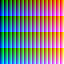

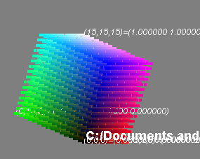 Put the result in the FX folder (so it loads at startup) and use it as a 3D LUT.

An example: taking the patch and converting it to grayscale would yield a cube where all vertices are in a single line — this is how a grayscale 3D LUT looks when visualized in JefeCheck. More extreme color processes produce more deformed cubes. You can plot any LUT directly in JefeCheck using the LUTs panel (see Visualizing LUTs).

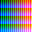

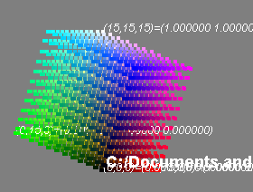

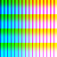

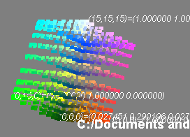

---

### Creating new FX plug-ins

Creating a new FX plug-in for JefeCheck is quite easy if you have some experience with a shading language, particularly the OpenGL Shading Language, and some knowledge of XML.

JefeCheck's FXs consist of three files:

- `file.jfx` — An XML descriptor file
- `file.frag` — An OpenGL fragment shader
- `file.vert` — An OpenGL vertex shader

The `.vert` and `.frag` files define OpenGL Shading Language vertex and fragment shaders. The `.jfx` file is a simple XML text file that describes the FX, its controls, the variables that affect the shaders, and the names of the shader files.

It is easier to understand by example. The following sections describe the MIX FX as a worked example.

#### The .jfx File Format

The `.jfx` is an XML tree with the following structure:

**`root` node:** The root node of the XML file. Must contain a `comment` attribute with whatever text you wish.

**`general` node:** Contains descriptive information on the FX in the following attributes:
- `Description` — A brief description of what the FX does (e.g., `"Blend two images together"`).
- `menuName` — Where the FX appears in the FX panel's **+ Add FX** menu (e.g., `"Comp/Mix"` will make the FX appear in a submenu called **Comp** with the name **Mix**).
- `version` — The version number of the FX (e.g., `"2.0"`).
- `author` — Who wrote the FX (e.g., `"Daniel Gollas"`).
- `name` — The name shown on the FX's card in the FX panel (e.g., `"Mix"`).

**`groups` node:** Contains a series of `group` nodes, each containing controls and variables for use within the shaders. Each control group can have a name that will be displayed in the GUI.

**`group` node:** Contains a series of `widget` nodes and has a `name` attribute (e.g., `"Parameters"`).

**`widget` node:** Each widget represents a GUI element for the FX. The GUI element is linked to a uniform variable in the shaders. Available widget types:

- `float` — Creates a numeric input and passes a floating-point value to the shaders.
- `bool` — Creates a checkbox and passes `1.0` or `0.0` to the shaders.
- `texture` — Creates a selection box and passes a rectangular 2D texture sampler to the shaders. The selection box contains **Previous** and **Track A** to **Track D**. Track A–D is the image for that particular track. **Previous** passes the previous FX's result to the shader — this is what allows FXs to be stacked. If you don't specify any texture widgets, the previous texture will be passed by default with the variable name `image`.
- `cube` — Creates a selection box and passes a 3D texture sampler containing a 3D LUT. The box is filled with all loaded 3D LUTs.
- `lut` — Creates a selection box and passes a 1D texture sampler containing a 1D LUT. The box is filled with all loaded 1D LUTs.
- `choice` — Creates a selection box and passes a floating-point number representing the index of the selected item. A `choice` widget must have child nodes named `choice`, each with a `label` attribute specifying the text to appear in the selection box (see `OVER.jfx` for an example).
- `newline` — Makes the following widgets appear on the next line.
- `spacer` — Creates a space between the previous widget and the next. Must have a `width` attribute specifying how much space is added.

How controls are laid out: a slider always takes a line of its own. Every other control (knobs, fields, checkboxes, selection boxes) shares a line with its neighbours until the next `newline`, and that line wraps when the panel is too narrow to fit them. A `spacer` adds a fixed gap inside such a line.

Each `widget` node must contain these attributes (italic = optional):

| Attribute | Description |
|-----------|-------------|
| `type` | One of the widget types above (e.g., `"texture"` or `"float"`) |
| `varName` | Links the GUI to the shaders — the uniform variable with this name in your shaders will contain this widget's value |
| `label` | The label that appears in the GUI for this widget |
| `minimum` | The minimum allowed value for `float` type widgets |
| `maximum` | The maximum allowed value for `float` type widgets |
| `step` | Decimal precision for `float` type widgets (`0.1`, `0.01`, `1.0`, etc.) |
| `default` | The default value for the widget |
| `labelColorR`, `labelColorG`, `labelColorB` | Together define the label color (0–255 each) |
| *`style`* | How a `float` widget is drawn: `slider` (the default), `knob` or `field` (not case-sensitive). An unknown style draws a slider and prints one warning when the FX loads |
| *`softMinimum`*, *`softMaximum`* | The slider and scrub range of a `float` widget, inside `minimum`–`maximum`. Typed values may still go anywhere between `minimum` and `maximum` |

Without `softMinimum`/`softMaximum`, the soft range is the full `minimum`–`maximum` range when that spans 100 or less; for a wider range it becomes `minimum` to twice the default (at least `minimum` + 1) when `minimum` ≥ 0, else the default ± max(|default|, 1). An unreadable soft end is skipped, a soft end outside `minimum`–`maximum` is clamped to it, and an empty or reversed soft range is ignored; each prints one warning when the FX loads.

**`shaders` node:** Specifies the names of the shader files:
- `vertex` — Filename of the vertex shader (e.g., `"fixed.vert"`).
- `fragment` — Filename of the fragment shader (e.g., `"MIX.frag"`).

Many FXs can share the same shader files — most included FXs use the `fixed.vert` vertex shader, but each has its own fragment shader.

#### Example: The MIX FX

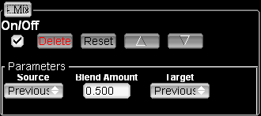

Here is the complete `MIX.jfx` file:

```xml
<?xml version = '1.0' encoding = 'UTF-8'?>
<root comment="this is the root node" >
  <general Description="Blend two images together" menuName="Comp/Mix" version="2.0" author="Daniel Gollas" name="Mix" />
  <groups>
    <group name="Parameters" >
      <widget type="newLine" varName="0" />
      <widget labelColorR="255" labelColorB="255" type="texture" default="0" label="Source" labelColorG="255" varName="first" />
      <widget labelColorR="255" labelColorB="255" type="float" step="0.001" default="0.5" label="Blend Amount" minimum="0" labelColorG="255" maximum="1" varName="Amount" />
      <widget labelColorR="255" labelColorB="255" type="texture" default="0" label="Target" labelColorG="255" varName="second" />
      <widget type="newLine" varName="0" />
    </group>
  </groups>
  <shaders vertex="fixed.vert" fragment="MIX.frag" />
</root>
```

The `general` node describes the FX. The `groups` node contains one group called "Parameters" with two `texture` widgets and one `float` widget — reflecting the FX's need to select two images and a blend amount.

#### The Vertex Shader

Most of the time you won't need to change the vertex shader unless you are familiar with vertex shaders and have a specific need. The vertex shader must at minimum pass the texture coordinates for 4 texture units to the fragment shader. The standard `fixed.vert` vertex shader is:

```glsl
void main()
{
    gl_TexCoord[0] = gl_MultiTexCoord0;
    gl_TexCoord[1] = gl_MultiTexCoord1;
    gl_TexCoord[2] = gl_MultiTexCoord2;
    gl_TexCoord[3] = gl_MultiTexCoord3;
    gl_Position = ftransform();
}
```

#### The Fragment Shader

The fragment shader is where most of the action happens, since FXs are essentially designed for 2D image processing at the pixel level. The shader receives its uniform variables from the application through the widgets declared in the `.jfx` file. Here is the `MIX.frag` fragment shader:

```glsl
uniform float Amount;
uniform sampler2DRect first;
uniform sampler2DRect second;

void main()
{
    gl_FragColor = mix(
        texture2DRect(first,  gl_TexCoord[0].st),
        texture2DRect(second, gl_TexCoord[1].st),
        Amount);
}
```

The `uniform` variables (`Amount`, `first`, `second`) receive their values from the GUI through the `varName` attributes in the `.jfx` file. The `main` function is the entry point, and the resulting pixel color must be assigned to `gl_FragColor`.

In this example, we sample the color values of the two textures using `texture2DRect`, passing the first or second sampler along with `gl_TexCoord[0]` or `gl_TexCoord[1]` respectively (this is why the vertex shader must pass the appropriate texture coordinates). Then we use the GLSL `mix` function to linearly interpolate between the two samples by the `Amount` parameter.

You should always use texture coordinate index 0 for the first declared sampler, index 1 for the second, etc.

#### Additional Uniform Variables

Aside from the uniform variables declared in your `.jfx` file, the application also provides a few additional variables. You don't have to use them, but if you do you must declare them as uniform variables in your shaders:

| Variable | Type | Description |
|----------|------|-------------|
| `texCoord0` to `texCoord4` | `vec2` | Hold the size of the four possible textures passed to the shader. |
| `currentFrame` | `float` | The current timeline value. |
| `timeStep` | `float` | Number of milliseconds since we last drew the frame. |
| `targetFPS` | `float` | The target FPS. |
| `X_size` | varies | The size for 3D LUT cube X. If your shader uses a 3D LUT variable named `myLut`, you will also receive `myLut_size` containing the size of that LUT. |

You should look at all the other included FXs to get an idea of the range of things you can do.

---

## Appendix: Screenshots

The following screenshots are from the original 2014 release. They show the old interface and need to be retaken for JefeCheck 2.0:

| Image | Description |
|-------|-------------|
| MainWindow.png | Main application window |
| LoadWindow.png | Load Window |
| LoadParameters.png | Load parameters (empty) |
| LoadParameters-Populated.png | Load parameters (populated with sequence info) |
| ControlBar.png | The Control Bar |
| TimeLineControls.png | Timeline and track controls |
| TrackControls.png | Track controls row |
| TrackBar.png | Track bar showing loading progress |
| trackSelectionBox.png | Track selection box in viewport controls |
| TrackLoadingMode.png | Track loading mode indicator |
| cancelLoading.png | Cancel loading button |
| StartCancelButtons.png | Start and Cancel buttons in Load Window |
| PlaybackControls.png | Playback controls |
| ViewportControls.png | Viewport controls panel |
| SingleViewportControl.png | Single viewport control panel |
| TransformationControls.png | Transformation controls (zoom, pan, rotate) |
| FlipFlopControls.png | Flip and flop controls |
| AspectControls.png | Aspect ratio controls |
| ChannelMaskControls.png | RGBA channel mask controls |
| MenuBar.png | The Menu Bar |
| PreviewInformation.png | Preview information overlay in viewport |
| PreviewText.png | Viewport text overlay during playback |
| DPXMetadata.png | DPX metadata displayed on viewport |
| CropSample.png | Crop region selection on a frame |
| LUTManager.png | The LUT Manager Window |
| grayScaleLUT.png | Grayscale 1D LUT visualization |
| GrayscaleCube.png | Grayscale 3D LUT cube visualization |
| PerfectCube.png | Perfect (unmodified) color cube visualization |
| canonicCube.png | Canonical cube visualized as a 3D cube |
| canonicCubeImage.png | Canonical cube image (the 64×64 LUT source patch) |
| ViperZodiac.png | Example test footage (Viper Zodiac) |
| ViperZodiacCube.png | Viper Zodiac image processed through a 3D LUT |
| ContrastedAndBrightened.png | Example image with contrast and brightness applied |
| ContrastedAndBrightenedCube.png | Resulting cube after contrast/brightness color correction |
| FXManager.png | The FX Manager Window |
| FXStackManager.png | The FX Stack Manager (FX Control Window) |
| DeleteFX.png | Delete FX button on an FX stack entry |
| MixGUI.png | Mix FX GUI in the FX Stack Manager |
| RemoteSessionManager.png | The Remote Session Manager Window |
| RenderWindow.png | The Render Window |
| Clipboard05.png | Playlist window screenshot |
