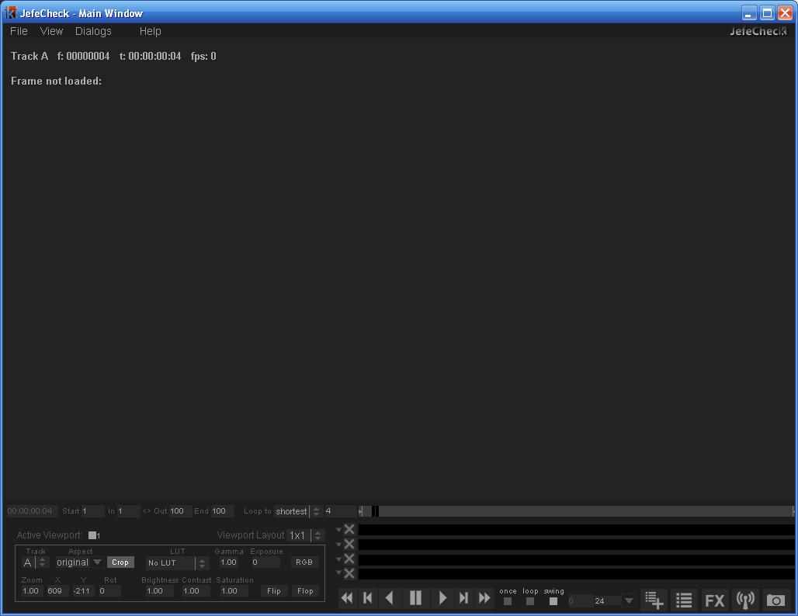
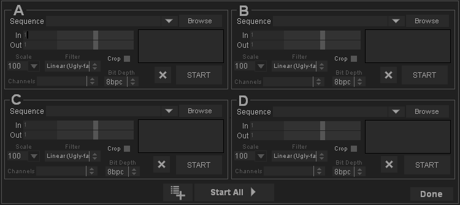
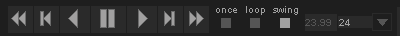
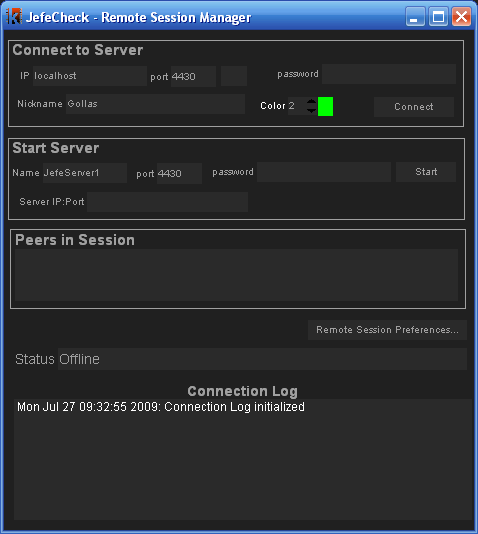

# JefeCheck 2.0 Quick Reference

> The screenshots in this guide are from the 2014 release and do not show the current interface. On macOS, `Ctrl` in shortcuts means `Cmd` and `Alt` means `Option`.

## Loading

### How to Load an Image Sequence into Track X

1. Open the Load Sequence Manager (**File > Load Sequence Manager…** or `Ctrl+L`).
2. Click the Browse (folder) button on the strip for track X.
3. Select any frame of the sequence and click Open.
4. Click **Load All**.

OR

Use **File > Quick Load…** (`Ctrl+O`) and pick any frame. It loads straight into the active plate's track.

OR

Drag and drop a single file from the sequence onto the viewport. It loads straight away into Track A. If the Load Sequence Manager is open, the file goes into its first strip as a preview instead, and nothing loads until you click **Load All**.

OR

Drag and drop a folder onto the viewport. The first image or movie file in it (by name) is loaded.

OR

Drag and drop a file onto a track's lane in the Timeline panel to load it into that track.

### How to Load a Movie (.mov / .mp4 / .mxf)

JefeCheck plays ProRes (422, HQ, 4444, XQ), H.264, H.265 and DNxHR movies in `.mov`, `.mp4` and `.mxf` files, with sound.

1. Load the movie exactly like an image sequence: Browse to it in the Load Sequence Manager, Quick Load it (`Ctrl+O`), or drag and drop it onto a viewport or a track lane.
2. The movie becomes one track. Range, scale, bit depth, crop, hold, offset and notes all work as they do for a sequence, and the timeline counts its frames from 1.
3. The player's frame rate is set to the movie's own rate (for example 23.976). If you load several movies, the last one loaded sets the rate; other tracks play one frame per timeline frame at that rate.

> **Note:** A movie is decoded into memory, so, like a sequence, only what fits in RAM is loaded. Very heavy 4K ProRes 4444 may load slower than real time; once it is loaded it plays at full speed. Numbers in a movie's file name are never treated as frame numbers.

### How to Load Only a Certain Range of an Image Sequence

1. Follow steps 1 through 3 of [How to Load an Image Sequence into Track X](#how-to-load-an-image-sequence-into-track-x)
2. Set **From** and **To** on that track's strip in the Load Sequence Manager.
3. Click **Load All**.

### How to Load a Sequence as a Lower Res Proxy

1. Follow steps 1 through 3 of [How to Load an Image Sequence into Track X](#how-to-load-an-image-sequence-into-track-x)
2. Choose 100%, 50% or 25% in the strip's **Scale** box. The resampling filter is set in **File > Preferences… > General > Default decode filter**.
3. Click **Load All**.

OR

Hold `Shift` while you drop a file onto the viewport to load it at 50%, or `Shift+Ctrl` for 25%.

### How to Load Y Number of Sequences into Several Tracks

1. Follow steps 1 through 3 of [How to Load an Image Sequence into Track X](#how-to-load-an-image-sequence-into-track-x) with up to four tracks (A, B, C and D).
2. Click **Load All**.

### How to Load Only a Specific Region of an Image Sequence

1. Follow steps 1 through 3 of [How to Load an Image Sequence into Track X](#how-to-load-an-image-sequence-into-track-x)
2. Tick **Crop** on that track's strip.
3. Select the region you wish to load on the preview image in the viewport. Drag the region to move it; drag its corner markers to resize it.
4. Click **Load All**.

### How to Load an Image with 16 Bit Floating Point Precision

> **Note:** This will store images in 16 bit in memory, allowing greater precision when modifying 16 bit per component images with JefeCheck's FXs at the cost of double the memory usage. You don't need to do this to simply load and playback 16 bit per component images — ONLY do it if you are experiencing problems when doing heavy processing.

1. Follow steps 1 through 3 of [How to Load an Image Sequence into Track X](#how-to-load-an-image-sequence-into-track-x)
2. Choose **16-half** or **16-bit** in the strip's **Bit** box. (The default for Quick Load and drag and drop is set in **File > Preferences… > General > Default bit depth**.)
3. Click **Load All**.

### How to Start Loading a Sequence from a Certain Point in the Timeline

Click anywhere on the timeline. JefeCheck loads around that frame first: the frame appears after a short wait, the frames after it load next, and playback carries on from there. You don't have to fit the whole sequence into memory to look at any part of it.

`Alt+Left Click` on the timeline (or on a specific track) jumps to that frame. `Alt+Shift+I` sets the IN point at the current frame. With the rolling cache on (the default) that frame is already loading, so nothing else happens; with it off (below), both also reload every track from that frame until memory is full.

### How to Load a Fixed Stretch Instead of a Rolling One

The circular-arrow button at the right of the Timeline's transport row turns the **rolling cache** on and off.

- **On** (default): frames load around the playhead and unload behind it, so a clip longer than memory plays end to end.
- **Off**: every track loads from the IN point until memory is full and keeps those frames; moving the playhead doesn't change what's loaded. Playback follows the loop mode (Once, Loop, Bounce) over what is loaded, using the loop priority: Shortest stops at the end of the track with the least loaded, Longest at the end of the track with the most, Timeline at the IN/OUT points. `Alt+Left Click` on the timeline, or `Alt+Shift+I`, loads from another frame instead.

The setting is remembered between launches.

### How to Review a Clip Longer Than Memory

1. Load it as usual. You don't need to set a range or a lower resolution to make it fit.
2. Press play. Frames load ahead of the playhead and frames behind it are unloaded to make room, so the clip plays to the end. The sound is loaded separately and never drops out.
3. To look at another part, click there on the timeline; that frame appears after a short wait.
4. If loading is slower than playback (very heavy 4K, for example), **File → Preferences… → General → When loading can't keep up** chooses between keeping time with the sound (skipping frames that aren't ready) and showing every frame (playing slower). By default clips with sound keep time and clips without sound show every frame. **Memory limit (% of RAM)** on the same page sets how much of the machine's memory may be used (default 90%).

A range or loop that fits in memory loads once and stays loaded, however many times you play or scrub it.

### What the Green Segments Under a Track Mean

The green segments on each track's lane in the Timeline panel (`F8`) are the frames that are in memory right now. They move with the playhead: frames ahead of it turn green as they load, and when memory is full, frames behind it are unloaded and lose their green. The frames just behind the playhead are unloaded last, so after playing and pausing, stepping back is instant. A gap is not an error; clicking a frame in a gap loads it. A frame that can't be read shows black, and playback carries on past it.

---

## Playback

### Change the Layout of the Viewports

Press `Ctrl+1` (single), `Ctrl+2` (side by side), `Ctrl+3` (top and bottom) or `Ctrl+4` (2x2).

### How to Change What Track Is Displayed on Each Viewport

Select the track (A, B, C or D) in the **Track** box on that viewport's card in the Plate Manager (`F2`).

OR

Click the viewport and press `Up` or `Down` to move through the tracks.

### How to Transform a Viewport

- Left click and drag on a viewport to pan.
- Use the mouse wheel (or pinch on a trackpad) to zoom in and out.
- Hold `Alt` while dragging (or pinching) to apply the change to all viewports.
- Zoom, X, Y and Rotation are also on the viewport's card in the Plate Manager (behind the zoom button when the dock is at the top or bottom).
- Press `V` to flip and `M` to flop the active viewport, or use the Flip and Flop buttons on its card. Add `Shift` for all viewports.
- Press `F` to fit the image to the viewport (`Shift+F` for all viewports).
- Press `Ctrl+R` to reset the active viewport's transformations, or `Ctrl+Alt+R` for all viewports.

### How to Color Correct a Viewport

1. Select a LUT from the LUT box on the viewport's card, or select it in the LUTs panel (`F4`) and click **Apply to active plate**.
2. Adjust Gamma in the Gamma box, or hold `W` and drag left/right on the viewport.
3. Adjust Exposure in the Exp box, or hold `E` and drag.
4. Adjust Brightness (hold `Q` and drag), Contrast (hold `D`) or Saturation (hold `S`). Their boxes are on the card, behind the **Color** button when the dock is at the top or bottom.

Hold `Alt` as well to adjust every viewport.

You can reset the color correction on a viewport by pressing `Shift+R`, or `Shift+Alt+R` to reset all viewports.

To keep a color correction, use **View > Color Correction Favorites > Save to Slot 1–5**. Apply it later with **Load Slot 1–5**. Favorites are kept between launches.

OR

Apply one or more FXs like Primary Color Correction, Brightness-Contrast-Saturation, Gamma, etc.

### How to Change the Aspect Ratio of a Viewport

Click the aspect button on the viewport's card and choose a ratio, or type your own. **source** is the default; it keeps the image's own ratio.

Turn on **Letterbox** in the same popup to show the new ratio with black bars instead of stretching the image.

Change the opacity of the bars in **File > Preferences… > General > Aspect-bar opacity**.

### How to See the RGBA Channels on a Viewport

Click the channel button (it shows **RGB**) on the viewport's card to step through RGB, R, G and B.

### How to Control the Playback

The transport is in the Timeline panel (`F8`).

- Play/pause: `Space`. Play backward, pause, play forward: `J`, `K`, `L`. Go to start: `Home`. Go to end: `End`.
- Step one frame back or forward: `Left`/`Right`.
- Play direction reverse/forward: `,`/`.` (the `<` and `>` keys).
- Scrub by clicking and dragging on the timeline bar.
- Choose **Once** (`8`), **Loop** (`9`) or **Bounce** (`0`) in the loop mode box.
- Set the In and Out points with `I` and `O`, go to them with `Shift+I` / `Shift+O`, and reset them to the timeline's ends with `Alt+I` / `Alt+O` (`Alt+X` for both), or type them in the **In** and **Out** boxes.

### How to Change the Keyboard Shortcuts

Open **File > Preferences… > Shortcuts**. Double-click a key and press the new one; `Backspace` while capturing removes it, and a bar offers **Replace** if another command already has the key. A dot marks changed keys (click it to reset), **Reset to preset** puts everything back, and **Import…** / **Export…** share a `.jcshortcuts` file with colleagues.

### How to Get the JefeCheck 1.7 Keys Back

JefeCheck 2.0 starts with the **Editing** keys (`J` `K` `L`, `I` `O`). Choose **JefeCheck 1.7** in the Preset menu of **Preferences > Shortcuts**, or click **Use 1.7 keys** in the bar shown on first launch. The manual lists every difference under Keyboard Shortcuts, Coming from JefeCheck 1.7.

### How to Hear or Mute a Movie's Sound

Every loaded movie with sound plays at the same time, mixed together. Click the speaker icon on a track's lane in the timeline to mute or unmute that track (or right-click the lane and choose **Mute audio**). Muting is saved with the session, and the lane's waveform dims while muted.

- At the movie's own frame rate the sound leads and the picture keeps up with it.
- Stepping, scrubbing, or playing at another frame rate plays each frame's own slice of sound at normal pitch.
- Playing in reverse is silent.

### How to Offset a Track on the Timeline

Click and drag the track's lane in the Timeline panel left or right.

OR

Right-click the lane, choose **Set offset…**, and type the offset in frames.

### How to Hold a Specific Frame on a Track

Right-click the track's lane in the Timeline panel and tick **Hold last frame**. Untick it to play the track normally again.

### How to Unload a Track

Open the Load Sequence Manager (`Ctrl+L`) and click the **Unload & Clear** (trash) button on that track's strip.

### How to Show or Hide Text Information

Press the shortcut key `T` to toggle display of information text on the viewport, or press `Alt+T` to toggle it on all viewports.

If the track has DPX, EXIF or OpenEXR metadata, it will be shown.

### How to Show DPX Metadata on the Viewport

If the track has a DPX image sequence loaded, press `T` until the metadata mode is on (the modes are none, normal and normal+metadata).

### How to Show the Shortcut Help

Press `H` to show or hide the on-screen help, which lists the keyboard shortcuts.

### How to Show a Histogram

Press `Ctrl+H` (or **View > Show Histogram**) for the active viewport, or `Ctrl+Alt+H` for all viewports. Drag the histogram to move it.

---

## Processing

### How to Load a JefeCheck FX

Every FX in JefeCheck's FX folder loads at startup. Add a new FX by putting its `.jfx`, `.frag` and `.vert` files in that folder and restarting JefeCheck.

### How to Load a LUT

LUTs in JefeCheck's FX folder load at startup and are listed in the LUTs panel (`F4` or **Window > LUTs**).

To load another one, drop a `.lut`, `.cube` or `.cub` file onto the LUTs panel. Click the Refresh button to rescan the LUT folders.

### How to Apply One or More FXs to a Viewport's FX Stack

1. Open the FX panel (`F3` or **Window > FX**).
2. Click the viewport where you want to apply the FX.
3. Click **+ Add FX** and choose the FX from its category submenu.
4. Turn the FX on or off with the power button on its card.
5. Repeat steps 3 and 4 for each FX you want to add.

### How to Change the Position of an FX in the FX Stack

Drag the FX's card by its handle (at the left of the card's header) to a new position.

### How to Reset an FX Parameter

Click the reset dot at the end of the parameter's row, or right-click the parameter and choose **Reset to default**. A parameter's label is orange while it differs from its default.

---

## Review

### How to Draw Notes on a Frame

1. Open the Notes panel (`F7` or **Window > Notes**).
2. Pick a tool: Freehand, Arrow, Box or Text. Pick a colour and size if you like.
3. Drag on the viewport to draw. With the Text tool, click and type the note.
4. Press `Escape` to put the tool down.

Press `N` to show or hide notes on the viewport. Use **Lock Round** in the Notes panel to freeze the current round's notes.

### How to Send Notes to Someone Without JefeCheck

Use **File > Export Review Summary…** and choose PDF, text or CSV.

### How to Send a Review to Another JefeCheck User

Use **File > Export Review Package…**. It bundles the session, its notes, any LUTs you loaded yourself and, if **Include media** is ticked, the footage, into one `.jcreview` file. The other person opens it with **File > Open Review Package…**.

---

## Remote Session

### How to Start a JefeCheck Remote Session Server

1. Open the Remote Session window (`F5` or **Window > Remote Session…**).
2. Choose **Host** and fill in:
   - **Name:** the session name
   - **Port:** the port to listen on (default 60000)
   - **Password:** optional but recommended
3. Click **Start hosting**.

### How to Join a JefeCheck Remote Session Server

1. Open the Remote Session window (`F5` or **Window > Remote Session…**).
2. Choose **Join** and fill in:
   - **Nickname:** how others see you
   - **Join with:** IP address
   - **Server** and **Port:** the host's address and port
   - **Password:** if the host set one
3. Click **Join**.

### How to Chat in a Remote Session

Type in the message box in the Remote Session window and press `Enter` (or click Send).

OR

1. Click the viewport and press `Enter` to start typing a message on the viewport.
2. Type your message.
3. Press `Enter` to send it, or `Escape` to cancel.

### How to Use Remote Pointers in a Remote Session

1. Connect to a Remote Session
2. Hold `Shift` and drag on the viewport. Everybody sees your pointer with your nickname next to it.

Set your pointer colour in **File > Preferences… > Remote**.
