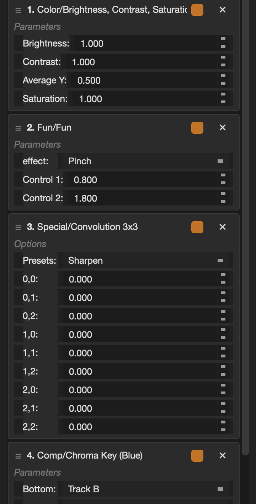
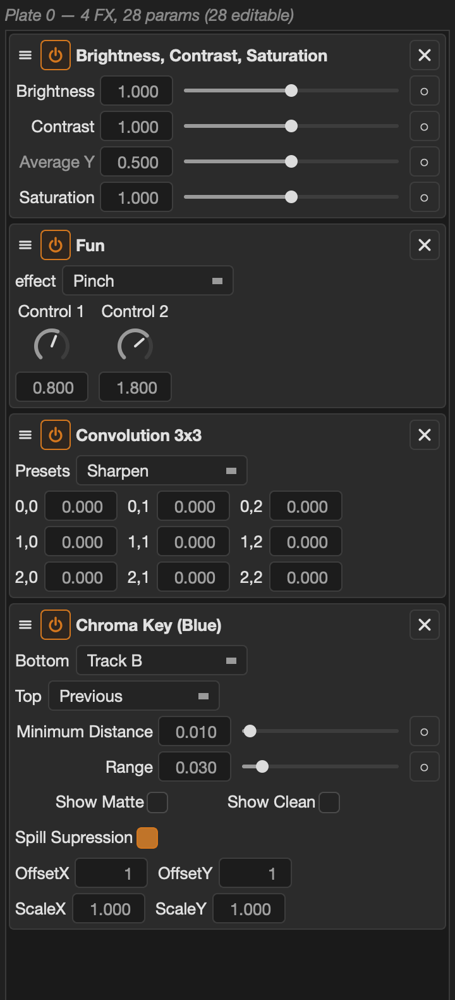
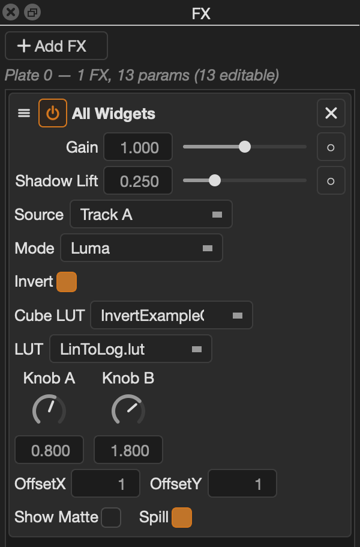
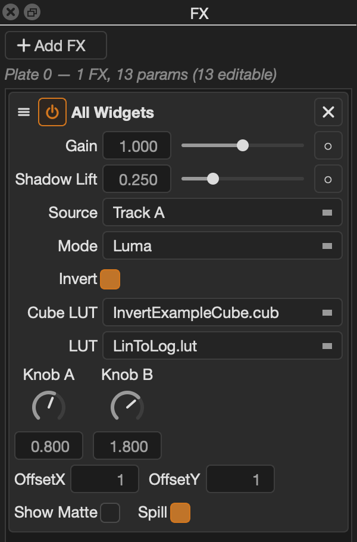
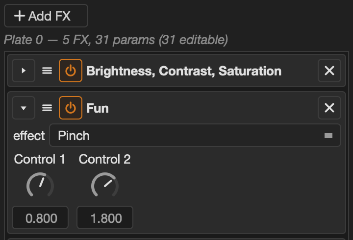
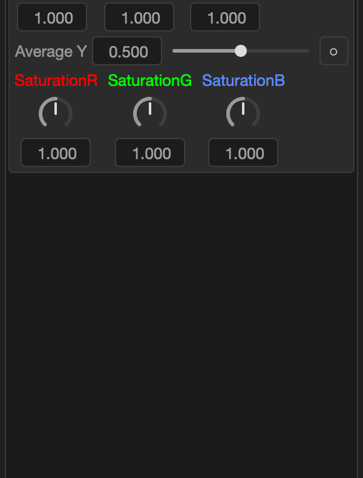

## What's new

Every FX parameter used to be the same spin box. Now each effect file says how its controls look:

- **Slider row:** label, value, slider and a reset dot on one line. The slider covers a sensible range (Brightness 0–2), but you can type past it: 5 stays 5.
- **Knob:** drag up or down to turn. Knobs share a line and wrap when the dock is narrow, as with Primary Color Correction's R, G and B.
- **Number field:** drag sideways on any value to change it, hold Shift for fine steps, and double-click (or press Enter or F2) to type.

A label turns orange when its value differs from the default. Click its reset dot, or right-click and choose **Reset to default**.

Here are the same four effects in the same 360 px dock: Brightness/Contrast/Saturation, Fun, Convolution 3×3 and Chroma Key (Blue).

### Single controls line up

A control alone on its line, such as a texture source, a choice, a LUT picker or a checkbox, now starts where the slider values start, with its label in the same right-aligned column. LUT pickers stretch to the card edge and show full names. Lines with several controls stay packed so they can wrap in a narrow dock.

### Fold an effect down to its title bar

The chevron at the left of each card hides its controls. The drag handle, power button and remove button stay, so you can still reorder and switch effects on and off while they're folded. A card stays folded when effects are added, removed or reordered.

### The effect decides

Primary Color Correction now has nine knobs labelled in red, green and blue. Its blue is lightened so it reads on the dark card.

### Also in this change

- **Old sessions keep their effects.** If an effect file has changed since a session, playlist or favourite was saved, the effect is found by name instead of being dropped. This also brings back effects in sessions saved before July. Remote sessions still need an exact match.
- **Each effect on a plate has a lasting identity,** so edits land on the right copy even when two of the same effect are stacked.
- Each card's on/off switch is a power icon that turns orange when on.
- Fixed: checked icon buttons (Flip, Flop, filmstrip, play) drew a dark symbol on a dark background; they're orange now. Numbers in effect and session files were misread on systems that use a decimal comma, such as German.
- Known issue: below about 290 px wide, the Convolution 3×3 grid wraps 2 + 1 per line. Nothing overlaps.

## How to use it

1. Press **F3** to show the FX dock and add an effect with **+ Add FX**.
2. Drag a slider, turn a knob by dragging up or down, or drag sideways on a number. Hold Shift for fine steps; double-click a number to type it.
3. Click a reset dot, or right-click a control and choose **Reset to default**.
4. Click the chevron on a card to fold it.

To give your own effect knobs or a different slider range, add `style="knob"` (or `slider`, `field`), `softMinimum` and `softMaximum` to its widgets in the `.jfx` file. A `newLine` widget starts a new line.

## Under the hood

An effect file asks for a style and a slider range per widget. Fun asks for two knobs that sweep −5 to 5, inside hard limits of −20 to 20:

{{quote src/FX/FUN.jfx#L18-L19 "Fun's two knobs in its effect file"}}

The panel reads those attributes, and anything it doesn't understand becomes a warning instead of an error:

{{quote src/gfcFXUi.cpp#L65-L77 "Reading a widget's style and soft range"}}

When the file gives no range, the slider gets one from the limits and the default, so a parameter allowed to reach 9999 still has a useful slider:

{{quote src/gfcFXUi.cpp#L47-L61 "Deriving a slider range from the hard limits"}}
