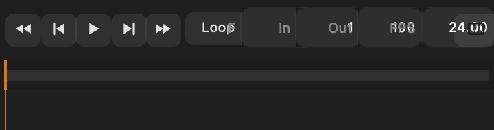
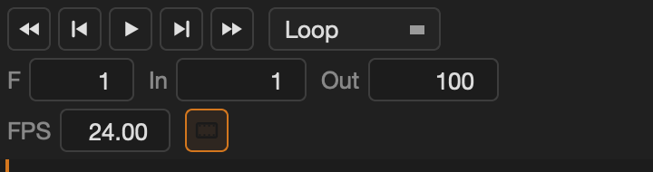
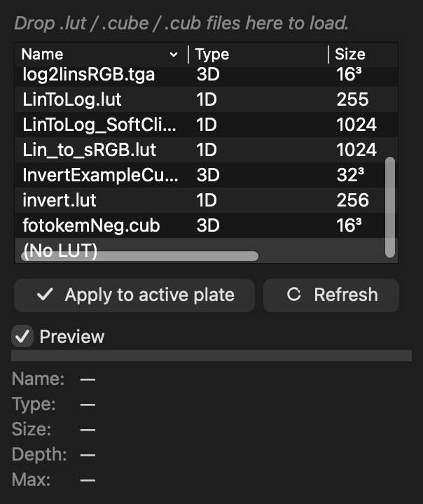
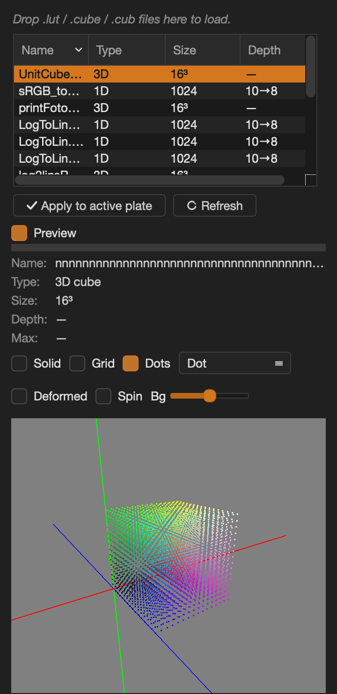
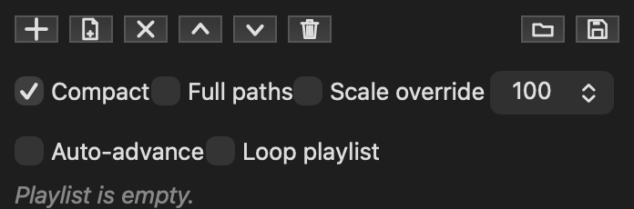
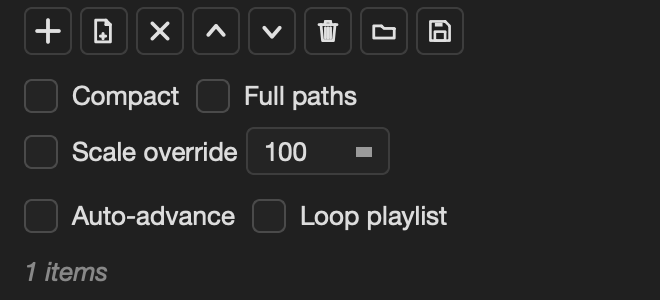

## What's new

Docks and dialogs used to size themselves however they liked. Now they share one rule:

- **24 px** for every control: buttons, fields, dropdowns and checkboxes. Icon buttons are 24 × 24 squares.
- **13 px** for all text. The scattered 8 pt and 10 pt overrides are gone; charts drawn inside a panel are the one exception.
- **4, 8 or 12 px** for every gap: 4 inside a pair, 8 between controls, 12 between groups.

The screenshots below come from the density test, which shows each dock 360 px wide in a 1280 × 800 window.

### The Timeline transport row wraps instead of piling up

In a narrow side dock, the frame fields slid underneath each other and the FPS box was cut in half. Now the row wraps onto as many lines as it needs, and every field has room for a 5-digit frame number.

### The LUT panel shows its preview and its depth

The layout no longer jumps between side-by-side and stacked as you resize the dock, and it stays stacked below 368 px. Long LUT names end in "…" instead of being cut off, and the Name column stays at least 80 px wide. The Depth column could show garbage from a value that was never set; it now shows "—" when the depth is unknown. A dock too short for its contents scrolls instead of squashing the list and the preview together.

### The Playlist controls line up

The toolbar buttons are 24 px squares instead of 30 px wide with heavy borders, the checkbox labels no longer run into each other, and "Scale override" wraps onto a new line together with its value.

Notes, the Load window, Preferences, Render, System Specs and About got the same treatment. Release builds also get the dark theme now: bundles built outside the repo used to miss the stylesheet, and the theme is now compiled into the app.

Known issue: if you narrow the Playlist dock by dragging only its width, its cards keep their old width until the height changes too.

## How to use it

Nothing to switch on. Dock any panel at the side, bottom or floating and resize it: rows wrap rather than overlap, and text that doesn't fit ends in "…".

To check a layout yourself, run `jefecheck --ui-density-test shots/`. It lays out every dock in five places at two window sizes, opens every dialog, repeats at 150 % scaling, saves a screenshot of each, and prints `UI-DENSITY RESULT PASS` or the controls that break the rule.

## Under the hood

The numbers live in one header, and the stylesheet sizes controls to match:

{{quote src/qt/UiMetrics_qt.h#L16-L21 "The density rule's constants"}}

The checker walks every widget in a panel and reports the ones that break the rule. Height and square icon buttons are the first two checks; cut-off text, overlaps, misaligned rows and odd font sizes follow:

{{quote src/qt/UiDensityCheck_qt.cpp#L138-L150 "Checking control height and square icon buttons"}}

The LUT preview picks side-by-side or stacked with some slack in between, so dragging the dock edge doesn't make it flip back and forth:

{{quote src/qt/LUTPreview_qt.cpp#L623-L631 "Choosing the LUT preview's layout direction"}}
