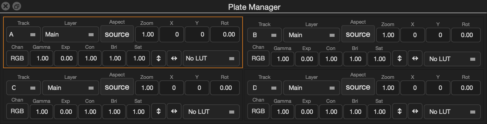
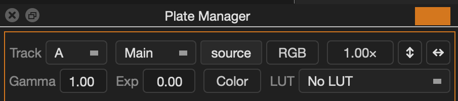
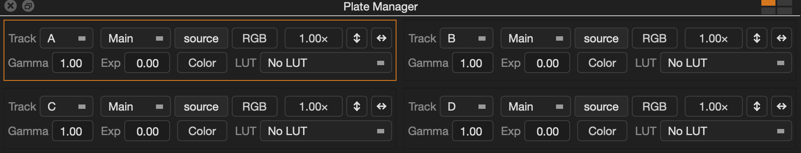
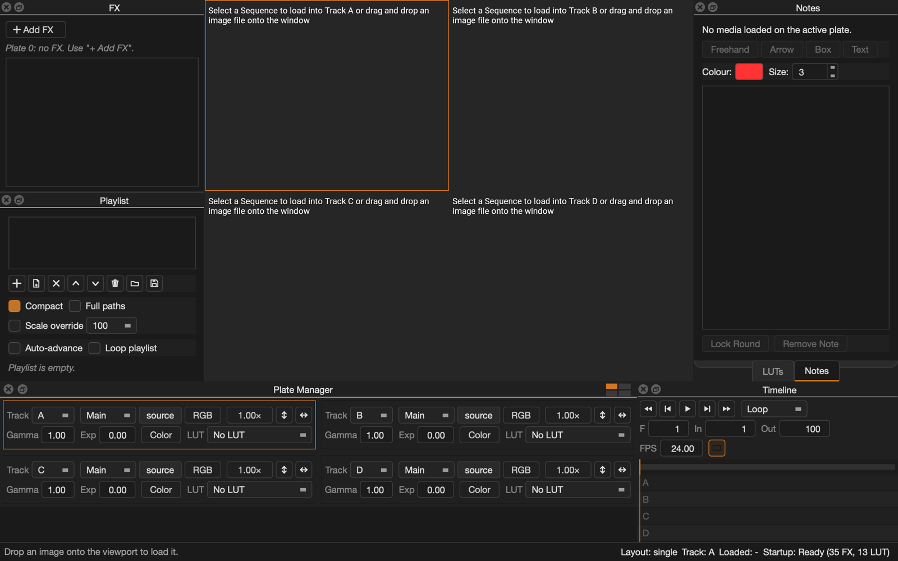
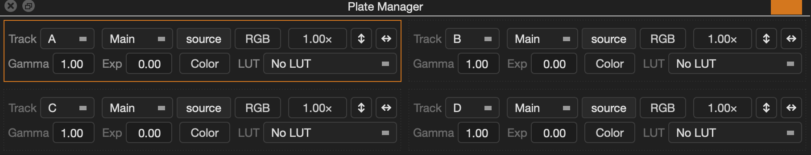
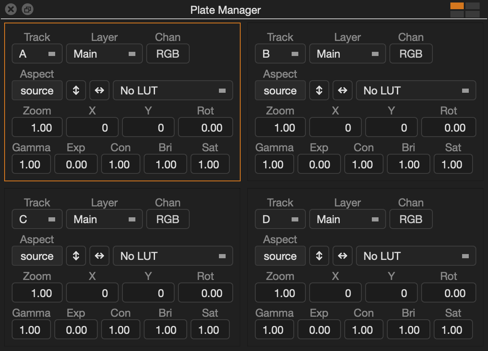

## What's new

The Plate Manager used to show all four plate cards all the time, even with one plate on screen. It now has three modes:

- **Active:** one card, for the plate you're working on.
- **Visible** (the default): one card per plate on screen. That's 1 in the single layout, 2 side by side or stacked, and 4 in the 2×2.
- **All:** all four, as before. Cards for plates that aren't on screen get a dashed border.

### One plate on screen, one card in the dock

In the single layout, the old dock still showed four cards, three of them for plates you couldn't see. Visible mode shows only plate A, and each card is down to two rows. The header row is gone: a small map of the plates sits in the dock's title bar.

### Four plates fit beside the Timeline

In the 2×2 layout on a 1280-wide window, the four cards sit in two rows of two next to the Timeline, in a dock 178 px tall instead of 202. Zoom, X, Y and rotation move into a **Transform** popup (the `1.00×` button), and contrast, brightness and saturation into a **Color** popup. Rows always come out even, so a wide window shows 2×2 or one row of four, never 3 + 1.

### Which plate is active? Look for orange

When more than one plate is on screen, the active plate gets a thin orange frame in the viewport, the same colour as its card and its square in the title-bar map. Click a square in the map to make that plate active.

All mode keeps every card and marks the ones that aren't on screen with a dashed grey border:

### The layout follows the dock

- **Top or bottom:** wide, two-row cards in even rows beside the Timeline, at most two rows tall. Drag the divider narrower and the cards drop to one scrolling column instead of being cut off.
- **Left or right:** tall cards in one column that scrolls to keep the active plate in view.
- **Floating:** the cards sit where their plates sit on screen, and the window resizes to fit them.

### Also in this change

- The **Panels** menu is now **Window**, and every panel has a key: Plate Manager F2, FX F3, LUTs F4, Remote F5, Render F6, Notes F7, Timeline F8, Playlist F9. On the Mac it also has Minimize (⌘M), Zoom and Bring All to Front.
- Zoom goes from 0.01× to 100×, and pan from −99,999 to 99,999 px. Sessions saved with larger values load clamped.
- The mode is remembered between launches.
- In a remote session, the dock updates its cards and map as soon as the host changes the layout.
- Fixed: a crash when a card switched form and back, and Ctrl+P being bound twice (it's now only Preferences).

## How to use it

1. Press **F2** to show the Plate Manager.
2. Choose **View → Plate Manager Shows → Active, Visible or All**, or right-click in the panel.
3. Click a square in the title-bar map to make that plate active.
4. Drag the dock to the side, the bottom or out as a floating window; the cards rearrange to fit.

## Under the hood

Which cards appear is a small, GL-free function of the mode and the viewport layout:

{{quote src/gfcPlateLayout.cpp#L18-L25 "Which plates each mode shows"}}

Cards in a row that has to wrap are spread evenly, so four cards that fit three per row go 2 + 2:

{{quote src/gfcPlateLayout.cpp#L34-L61 "Arranging the cards for each dock shape"}}

The orange frame is drawn after the plates, on screen only, so renders never include it:

{{quote src/gfcplatemanager.cpp#L1137-L1143 "The active-plate frame"}}
